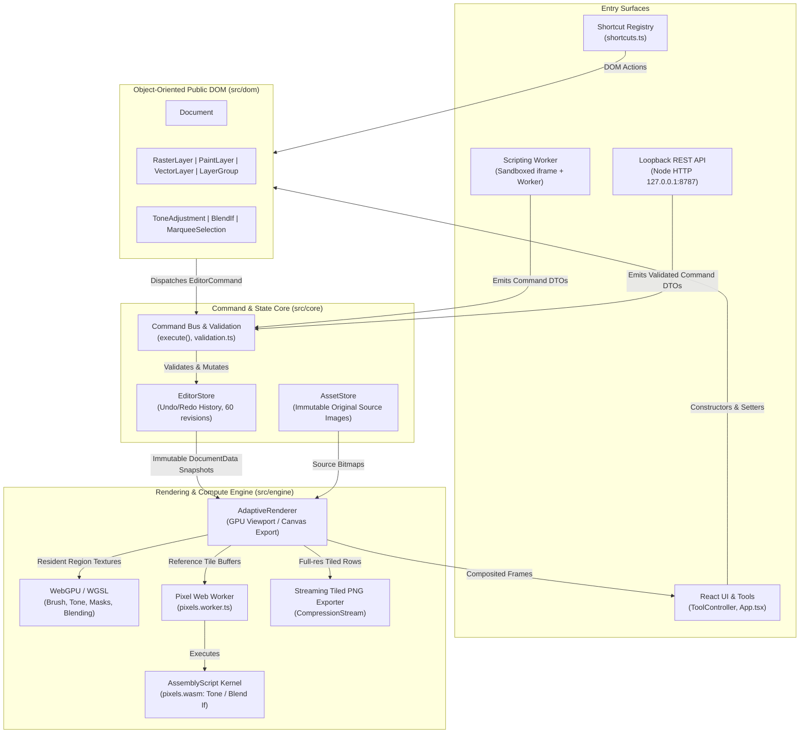

# Canoli Studio System Design & Architecture Specification

Pen overlay reconciliation retains every native control while memoizing long paths in contiguous 64-anchor blocks. A changed block refreshes its markers; unchanged blocks retain existing SVG nodes. Short paths render directly, and fragments preserve original SVG ancestry and paint order. Each block retains only its own at-most-64 point references, avoiding retention of complete prior path arrays across independent block updates. Basis, zoom, selection, geometry length/coordinates and the large-translation precision fallback remain invalidation inputs. This is a UI rendering optimization; public constructors, validation, history, persistence and isolated extension boundaries remain unchanged.

Native text spacing follows one shared state contract: OO text setters and strict commands validate schema-25 wordSpacing/fontKerning, then measurement, Canvas reference rendering, GPU reference textures and SVG preparation apply complete font/spacing/direction defaults. Whole lines stay in the browser shaping engine. Unsupported nondefault native controls reject explicitly; reset restores supported defaults in one command. Legacy valid roots/history migrate without inserting fields, and project/workspace/source asset boundaries stay unchanged. Schema-26 paragraph wrapping, gaps and indent share the native paragraph invariant below. Font substitution, headless estimated geometry and broader paragraph-style/variable-font/multilingual acceptance remain explicit limitations.

This document defines the system design, architectural boundaries, and non-negotiable invariants of Canoli Studio. All human contributors and AI coding agents working on this codebase must strictly adhere to these specifications.

---

## 1. High-Level Architecture

Canoli Studio is a browser-first, local-first image editor combining precision manual editing with future AI-assisted workflows. It decouples document representation, state mutation, image rendering, and execution surfaces.

---

## 2. Module Responsibilities & Boundaries

| Module                | Location                           | Responsibility & Rules                                                                                                                                                                   |
| :-------------------- | :--------------------------------- | :--------------------------------------------------------------------------------------------------------------------------------------------------------------------------------------- |
| **Public DOM**        | `src/dom/`                         | Public OOP constructors (`Document`, `RasterLayer`, `PaintLayer`, `VectorLayer`, `LayerGroup`, etc.). Browser-independent; wraps internal IDs; delegates attached mutations to commands. |
| **Core Model**        | `src/core/model.ts`, `drawing.ts`  | Plain, serializable Data Transfer Objects (DTOs) and structural schemas. Children are stored back-to-front. No UI state or pixel buffers.                                                |
| **Command Core**      | `src/core/commands.ts`, `store.ts` | Validated, atomic mutations and history management (undo/redo stack up to 60 revisions). Pure functions that transform document snapshots.                                               |
| **Validation**        | `src/core/validation.ts`           | Runtime schema validation (using Zod) for external commands and script results.                                                                                                          |
| **Asset Store**       | `src/core/assets.ts`               | Manages immutable original source images, small previews/thumbnails, and lifecycle cleanup.                                                                                              |
| **Persistence**       | `src/core/project.ts`              | Serializes/loads v2 `.luma` blob containers and legacy JSON. `src/core/recovery.ts` atomically persists local checkpoints/assets; see STORAGE_FORMAT.md.                                 |
| **Rendering Engine**  | `src/engine/`                      | Decoupled compositing pipeline (`DocumentRenderer`, `CanvasRenderer`), tile management, pixel worker communication, and streaming PNG export.                                            |
| **WASM Kernel**       | `assembly/pixels.ts`               | High-performance AssemblyScript pixel operations (exposure, contrast, saturation and Blend If math; Canvas 2D handles blend modes) compiled to `pixels.wasm`.                            |
| **Scripting Sandbox** | `src/scripting/`                   | Worker-based isolated JavaScript runtime inside an opaque-origin iframe. Sandboxed execution with a 5-second timeout.                                                                    |
| **REST API**          | `server/`                          | Local loopback prototype service (`127.0.0.1:8787`) using in-memory documents and revision-based conflict detection.                                                                     |
| **UI & Tools**        | `src/ui/`, `src/tools.ts`          | React UI, gesture controllers, tool settings, centralized keyboard shortcuts, custom dark theme tokens.                                                                                  |

---

## 3. Non-Negotiable System Invariants

### 1. Unified Object-Oriented DOM with Stable ID Indirection

- The public programming interface is strictly object-oriented.
- **Detached vs. Attached:** Constructors (`new RasterLayer(...)`) create detached instances. Adding a layer to a document or group attaches it.
- **Dynamic Handle Indirection:** Attached objects do not store mutable state in class fields. Instead, they store a stable `id` and read properties directly from the current document revision in `EditorStore`.
- **Handle Survival Across Undo/Redo:** Because handles resolve state by ID against the active revision, handles retained in code or UI remain valid after undo/redo cycles.

### 2. Pure Command-Driven Mutation & Synchronous Transactions

- **No Direct State Mutation:** Document trees and snapshots are strictly immutable outside commands. All UI gestures, shortcuts, scripting calls, and REST endpoints emit `EditorCommand` objects.
- **Transaction Atomicity:** Multi-operation edits run inside `Document.transaction(label, callback)`. A transaction groups all child commands into exactly **one** undo history entry.
- **Synchronous Only:** Transactions are strictly synchronous. Asynchronous work (e.g. decoding images, running worker jobs) must complete _before_ opening a transaction.

### 3. Asset Immutability & Decoupled Memory Budgets (No Fixed MP Limits)

- **Preserve Original Pixels:** Original imported images are immutable source assets in `AssetStore`. Edits, transforms, and adjustments never overwrite source data.
- **No Arbitrary Resolution Caps:** Never add arbitrary megapixel, image-byte, or dimension limits (e.g., no 8192px cutoff). Document dimensions are numeric coordinates in JavaScript safe-integer space.
- **Decoupled Allocations:**
  - Viewport renders visible document regions into preview surfaces (budgeted to $\le 4\text{ MP}$ / $4096\text{px}$).
  - Interactive layer/mask caches retain at most 64 MiB plus a 16 MiB active-stroke surface; painted-mask active coverage adds a separate bounded 16 MiB tile LRU. Cache eviction never changes source resolution. Export and clone tiles bypass viewport caching.
  - Pixel filters run on small tiles ($\le 1024 \times 1024$) in worker threads.
  - Full-resolution PNG export streams scanlines in bounded chunks ($\sim 4\text{ MB}$) directly through `CompressionStream('deflate')`.

### 4. Sandbox Isolation for Automation Surfaces

- **Scripting Security:** Scripts run off the UI thread in a Web Worker inside an opaque-origin sandboxed iframe. Network access, browser DOM, host objects (`window`, `fetch`), and raw pixel buffers are strictly blocked.
- **DTO Validation:** Scripts return command DTOs that are validated against strict Zod schemas before being applied as an atomic transaction.
- **REST Boundary:** The local REST server operates on separate in-memory documents and enforces concurrency via `expectedRevision`.

### 5. Multi-Threaded Engine & WASM Boundary

- **No Pixel Loops on Main Thread:** Pixel manipulation must run inside `src/engine/pixels.worker.ts`.
- **GPU path:** WebGPU/WGSL handles supported viewport pixel work; Canvas/WASM remains the export/reference and unsupported-device/effect fallback. Device loss must trigger a new fallback frame. GPU allocations never impose image import limits. See `ARCHITECTURE.md` for current shader scope, working budgets, tolerances and verification limits.
- **AssemblyScript vs. TypeScript:** AssemblyScript is a distinct, constrained language used exclusively for numerical pixel kernels (`assembly/pixels.ts`). General UI and business logic must remain in TypeScript.

### 6. Bespoke Design System & Centralized Shortcuts

- **No Third-Party Component Frameworks:** Do not introduce `shadcn`, Tailwind UI, or external widget libraries. Use the custom tokens in `src/ui/tokens.css` and custom components in `src/ui/controls.tsx` and `src/ui/Dialog.tsx`.
- **Central Shortcut Registry:** Keyboard binding definitions belong in `src/ui/shortcuts.ts`; the UI registers document-dependent actions against those definitions. Shortcuts must automatically suspend when text fields (`input`, `textarea`, `select`) have focus.

---

## 4. Agent Decision Matrix for Implementing Features

| Feature Type              | Required Implementation Path                                                                                                                                                                                                                              | Strict Prohibitions                                                                       |
| :------------------------ | :-------------------------------------------------------------------------------------------------------------------------------------------------------------------------------------------------------------------------------------------------------- | :---------------------------------------------------------------------------------------- |
| **New Interactive Tool**  | Implement pointer gesture tracking in `src/tools.ts`. Use transient command previews, or the internal paint-preview adapter for frame-paced incremental brush/pencil and painted-mask rendering. Commit a final DOM command/transaction on pointer up.    | Never commit history entries on every `pointermove`.                                      |
| **New Layer Type**        | 1. Define DTO in `src/core/model.ts`. 2. Add Zod schema in `src/core/validation.ts`. 3. Implement OOP class in `src/dom/index.ts`. 4. Implement rendering in `src/engine/renderer.ts`. 5. Handle thumbnail rendering in `src/ui/App.tsx`. | Never access layer-specific fields (e.g., `assetId`) without discriminating `layer.kind`. |
| **New Pixel Adjustment**  | 1. Implement numerical kernel in `assembly/pixels.ts`. 2. Expose message in `src/engine/pixels.worker.ts`. 3. Add effect DTO & command in `src/core/`. 4. Create DOM class in `src/dom/`.                                                     | Never execute pixel manipulation loops on the main UI thread.                             |
| **New Keyboard Shortcut** | Register in `src/ui/shortcuts.ts` and update keyboard table in `docs/REQUIREMENTS.md`.                                                                                                                                                                    | Never add ad-hoc `window.addEventListener("keydown")` in UI components.                   |
| **Scripting API Change**  | Re-bundle runtime script (`npm run build:runtime`) and update `docs/SCRIPTING_API.md` with runnable examples and signatures in the same change.                                                                                                           | Never document planned or unverified capabilities.                                        |

---

## 5. Agent Verification Checklist

Before completing any task, an agent must execute and report the results of these verification steps:

1. **WASM Build:** `npm run build:wasm` passes with no errors.
2. **Typecheck & Production Build:** `npm run build` (`npm run build:engine && tsc -b && vite build`) completes with zero TypeScript errors or bundling failures.
3. **Unit & Integration Tests:** `npm test` passes all test suites (`tests/dom.test.ts`, `tests/wasm.test.ts`, `tests/api.test.ts`).
4. **Browser & Invariant Verification:** For substantial engine, UI, or rendering changes, run the relevant Playwright tests (`npx playwright test`).
5. **Documentation Parity:** Ensure `docs/REQUIREMENTS.md`, `docs/ARCHITECTURE.md`, or `docs/SCRIPTING_API.md` are updated if any public behavior, command, or shortcut was altered.

### Canvas coordinate rebasing

Crop is a document operation, exposed as `Document.crop(bounds)` and `document.crop`. It changes canvas bounds while preserving source assets and local artwork; root positions, unlinked masks and pixel selections shift together. Locked layers participate while retaining lock flags. Command validation and a detached execution copy guarantee atomic rejection on unsafe coordinates. A session-only canvas revision marker invalidates transient tool coordinates on crop/resize and their undo/redo, including nested command transactions. This is the initial T07 crop foundation, not a full affine-transform or rotation model.

Image size uses the separate `document.resizeImage` command and `Document.resizeImage` method. It changes output dimensions and scales root affine placement, document-space masks/selections/guides and captured root comp placement. Children and source assets retain local data. It shares canvas-space gesture invalidation and atomic undo/revision behavior with crop/canvas resize. Pixel-based effect settings remain unchanged; output resampling uses existing renderer behavior.

## Rendered PSD export boundary (2026-10-15)

The trusted host export service plans independent pixel layers and required backdrop merges in `core/interchange/psd/export-plan.ts`, samples through the existing Canvas/WASM reference renderer, and writes bounded RLE strips/Blob parts in `engine/psd.ts`. The merged preview uses the original complete composition, not a second asset-only compositor. Per-layer straight pixels and white-matted preview channels have distinct precision contracts. UI preflight and explicit flatten/cancel describe discarded editability; document state, source assets and sandbox isolation are unchanged. The asset-only core helper rejects unsupported content. This extends a tested 8-bit PSD subset without claiming PSB/native Photoshop effects or full interchange/color parity.

### Color Range host boundary

Color sampling is asynchronous preparation; only validated, current-revision coverage reaches ordinary selection commands/history. Browser proxies never replace native source pixels. Dedicated render/image workers and bounded strips/bands separate document geometry from working allocations, while returned RLE can still be large. Plugin sampling requires current document and asset-read capabilities, enforced again at staged commit. The independent headless PNG-source endpoint performs bounded decoding/WASM analysis on its own session assets, with explicit unsupported formats and no browser scene rendering/synchronization. Cancellation, stale ownership/revision rejection and original-byte preservation are mandatory on both surfaces.

### Alpha channel invariants

Named channels are schema-21 independent document coverage, not editable layer references or mutable shared masks. Constructors and shared commands own changes/history; copy/crop/resize preserve the defined coordinate space. Native loading rasterizes complete Boolean expressions before composition, validates results/revision and commits once. Preview proxies never become native channel data. Dedicated bounded browser/Node workers preserve cancellation and script/plugin permission boundaries without reading source assets. Projects and retained undo/redo preserve channels; unsupported PSD channel interchange is disclosed.

### Quick Selection ownership and memory

Native brush growing prepares private source/state data; only validated current-revision coverage reaches shared selection commands/history. Source RGB is never given to scripts/plugins. Dedicated browser/Node workers terminate on cancellation; staged snapshots and current grants are authoritative at sampling and commit. Source tiles/PNG strips are bounded, while the current global connectivity planes consume actual native working memory. Allocation failure leaves artwork, imports and selection intact; no arbitrary image-resolution cutoff or source downsampling is allowed. Select Subject's separate native preparation below corrects its former rectangle/fabricated-source behavior.

Select Subject resolves original raster pixels separately from placement. Source-native coverage is prepared in a private worker, mapped by the complete world transform/placed scale and validated before a single shared selection transaction. The contrast/alpha heuristic cannot invent a source or fallback shape; empty evidence leaves prior state intact. Browser readback tiles yield to input, while the native RGBA plane and actual WASM/process limits remain explicit. Isolated staged snapshots and current image-reading/write grants apply through final commit; REST uses its own PNG assets and private decoder/native worker. No source data enters script globals and no browser/server synchronization is implied. Semantic/hair/transparency quality remains incomplete; native refinement integration is described below.

### Native matting asset and alpha invariants

Refinement separates original source geometry, complete world placement, display-only proxies and native worker/output budgets. Effective mask/selection coverage seeds a relative matte; intrinsic source alpha remains in the original or corrected foreground asset and is multiplied once. Original link behavior is preserved. Existing mask detail finer than source-native sampling can flatten; do not claim universal appearance preservation.

Private global matting (or explicitly chosen local Color line) and streaming PNG encoding precede a validated shared OO command transaction. Color correction must reach an actual new RGB asset/layer above the hidden original, never just a toggle with discarded pixels. Cancellation, stale source/revision/session, invalid output and lost plugin grants prevent asset transfer/late commit. Undo/redo/workspace/project references preserve successful assets. Sandbox code receives only validated plans; Node headless PNG sessions remain independent. Decoding/automatic Subject still have documented full native allocations. Default refinement now assembles one global closed-form system with hard constraints and cross-tile coupling. Validate disjoint native capture, graph budget and actual solver convergence before output. Explicit Color line retains the local estimator. Challenging-edge/semantic quality and broader device gates remain open.

Numerical matting preconditioning now uses budgeted IC(0), with safe diagonal shifts on the preconditioner and original-system residual certification. Capture insertion order, sparse symmetry and the factor transpose are explicit; source geometry and base graph capacity remain independent of optional factor memory. Failed factorization/capacity uses global Jacobi with diagnostics. Smooth strength is proportional and hard constraints remain exact. Natural-photo research evaluation is local, hash-pinned and separate from the unmodified sandbox timeout/asset/grant contracts.

Sparse matting rows are packed only after union/component classification and IC(0) construction finish. Values, neighbors and factors move together; dead rank/anchor bytes then hold total/lower entry counts. No union lookup may follow that phase, and no new persistent graph arrays may shrink the established operation capacity. Optional factor allocation failure retains global Jacobi; numerical/cancellation/asset/history gates still apply.

Optional coarse matting correction uses native-cell `[1,R,G,B]` basis columns, global Galerkin coupling and a ridge only on its coarse preconditioner. It augments the existing base preconditioner and tightens native residual certification to 1e-9, keeping 2,000 CG iterations. Reserve base/eligible IC(0) capacity before additional coarse memory/work; reject optional preparation into the original global route without an approximate matte. Component classification precedes reuse of union parents as coarse-cell indices; rank/anchors are reused later during row packing. Exact RGB24/initial-alpha packing shares the existing float64 sample vector. Frozen components never enter the coarse basis. Worker cancellation, isolated deadlines/grants and final native validation remain authoritative; headless state stays separate from the browser.

Packed matting iterations optionally execute in an isolated instance of the cached compiled pixel module. Fine matrix/neighbor/factor storage migrates chunkwise with rebound views after every memory growth; the original complete graph is never retained as a second persistent copy. Only reusable vector scratch and packed metadata add optional work. Budget this scratch, bookkeeping, page/prefix and transient chunk after the existing base/IC(0)/coarse estimates. No spare capacity or optional allocation RangeError retains the global JavaScript solve, even after partial migration. Ordinary pixel kernels cannot touch the private graph memory. Actual native residual/labels, priors, schemas, command history, plugin grants and isolated-script deadlines are unchanged. Logical graph estimates do not certify whole-process peak heap or GC behavior.

Design preflight is a read-only analysis boundary: OO callers request a versioned report, not a mutation plan. Core rules share strict policy/report validation and affine native-source sampling; browser geometry runs in a terminable dedicated worker, while scripts use their isolated worker and REST uses a private Node worker. Browser font evidence never crosses into plugin scripts. Asset metadata access retains current grants, and prepared reports retain snapshot/lifetime/asset checks. Authored bounds and sampling are evidence with explicit rendering/quality limits. Report truncation/work budgets are independent of document geometry and cannot imply that all omitted findings were checked clean. No new document schema, cloud call, mutation/history entry or plugin permission is introduced.

SVG vector extraction uses shared pure core/svg-path.ts and core/svg-export.ts encoders for constructor and browser-host output. The host preserves the nested vector/raster/text/paint/group tree and native affine/opacity/isolation semantics, yields between path fragments and reports unsupported constructs before download. Standalone layer serialization is synchronous in the layer's parent plane. Neither path changes commands/history, document geometry, original assets, REST sessions or plugin isolation. SVG remains a partial interchange surface; rendered edges/viewer CSS and rasterized mask geometry and native backdrop prefixes and their baked editability have explicit limits (see ARCHITECTURE.md).

SVG masks have a separate inspection/preparation boundary: core/svg-masks.ts retains eligible compound vector geometry, while engine/svg-masks.ts renders other coverage through the shared native mask/feather rules into bounded PNG tiles. Original bitmap RGB/source files are excluded. Immutable document placement, pinned asset identity/lifetime, cooperative cancellation and finally-based tile cleanup prevent mixed-source or partial output. Standalone constructors handle pure vector masks synchronously and reject native preparation; host export provides the native service without expanding script/plugin capabilities.

SVG style planning is a pure read-only core boundary shared by host and constructor output. Editable overlay/shadow graphs retain native compositing order with document-space effect operations under affine nesting. Conservative shadow-chain support is shared with native mask preparation, preventing off-canvas coverage loss. Transparent filter support extents preserve nested child shadows; downstream SVG group bounds may include them. This leaves commands, model geometry, source assets, scripts/plugins and separate REST sessions unchanged; viewer precision/allocation limits remain explicit.

SVG raster preparation is a trusted host-only boundary. Private `SvgImages` payloads contain sanitized embedded PNG pixels, source/document-plane placement and generated identifiers. Unmodified images retain decoded source resolution and share definitions; tone/erasure images bake native document-plane content over shadow support before independent SVG masks/styles/opacity. The native streamed PNG exporter bounds host tile/strip allocations. Source-file metadata is excluded, but masked/off-canvas source pixels remain in unmodified embedded images and must be disclosed. A shared dependency capture spans image and bitmap-mask preparation through final encoding, preventing mixed asset generations. No model mutation, source-byte replacement, schema, script/plugin capability or REST rendering is introduced.

SVG live text has a separate native measurement boundary. Private per-line baseline/color/spacing data feeds pure escaped text serialization while full affine, mask and style hierarchy stays shared. A small released measurement canvas and cooperative line batches avoid rasterizing text into document-sized surfaces. Registered referenced-family identities/status/descriptors are guarded across preparation/encoding; missing measurement, pending fonts and cancellation fail explicitly. Unrelated font loads do not invalidate output. Fonts remain references, with viewer substitution/hinting disclosed. Commands/history, isolated scripts/plugins and separate REST sessions retain their existing boundaries.

SVG smart-object preparation reuses the validated native component resolver under its existing logical render budget. Unfiltered masters expand into supported editable contents and geometric canvas clips; active filter stacks become native-rendered raw PNG leaves before separate outer SVG masks/styles/opacity. The plan captures only reachable visible native-filter asset/font dependencies and retains original project master identity/source bytes. Document-plane rebasing includes unlinked filter masks. Shared master links, baked filtered editability/off-support content and native backdrop-prefix editability are reported; source image dimensions remain independent of working budgets. No schema, mutation, script/plugin file privilege or REST rendering changes.

SVG paint has a read-only primitive boundary in core/svg-paint.ts and shares the pure native replay grid in core/paint-stamps.ts. Editable dabs/fills retain pressure/flow and isolated stroke opacity; ordered alpha masks erase only prior content. Clone pixels and stroke-selection coverage reuse existing trusted image/native-mask preparation with collision-free private keys. Only zero-outside stroke clips use transformed bounded support; ordinary masks keep complete inversion/density/feather semantics. Original brush commands and off-support dabs remain project data and are reported as absent from SVG. Numeric replay precision failures reject without changing geometry. Existing cancellation/source lifetime/cleanup, affine/style/mask hierarchy, immutable snapshots, schemas, shared commands/history, isolation and separate REST sessions remain unchanged.

SVG backdrop planning is a private read-only view after smart expansion. It captures only the dependent sibling prefix in each isolated scope; native adjustment/Blend If results become streamed document-resolution PNG content, with later siblings/outer settings retained separately. Original effect support survives baking. Native frame rebasing distinguishes expanded root unlinked masks from retained master coordinates. Complete visible source/font dependencies remain pinned through final encoding. Internal maps/placeholders never enter model persistence, commands or script/plugin services. Reports disclose lost internal editability/off-support pixels; standalone Blend If rejects without host preparation. Public geometry, schemas, original bytes, shared history and separate REST sessions remain unchanged.

### SVG file admission boundary (2026-10-16)

Trusted file input/drop → cancellable SVG preflight worker → inert XML/security scan → OO native reconstruction and validated private result → original embedded raster decoding/aspect placement or explicitly chosen image-mode/streamed-PNG flatten → complete new document session. No markup executes in the editor page. Script/foreign HTML/event/dynamic/entity/external-resource content rejects before either choice. Generation, revision, session and asset-lifetime guards surround async work/callbacks; temporary stores, bitmaps, renderer surfaces and workers release on failure. Editable imports preserve representable geometry and original embedded raster bytes while disclosing native budgets, cubic arcs, coverage differences and lost XML/master identity. REST/script/plugin boundaries remain separate; there is no new public plain-data mutation API or arbitrary image-resolution cutoff. Full SVG round-trip remains an open F07/F11 gate.

### Native vector stroke invariant (2026-10-16)

Schema-22 optional cap/join/miter/dash/offset fields flow through the same public OO constructors, path commands, immutable snapshots, current/history validation, scripting/plugins and separate REST sessions. Absence preserves legacy defaults; old schema labels cannot smuggle new fields. Native vectors set complete stroke state per path and use native lines for straight segments; vector-mask coverage remains on its established curve/grid path. Conservative miter/square support feeds shared culling/cache/effect bounds independently of image size. GPU vector reference uploads use the same renderer and invalidate with changed style data. SVG encodes validated literal fields and imports its distinct butt/miter defaults; unrepresented stroke extensions require explicit flattening. Containers/asset bytes/privileges remain unchanged.

### Editable vector gradient paint invariant

Schema-23 optional paint records are owned path values. Complete local/parent affine placement and an independent paint matrix apply consistently to native Canvas tiles, GPU reference textures and validated editable SVG paint servers. Paint transforms cannot change path geometry, and gradient coordinates cannot restart at tile/cache origins. Inert SVG import uses actual cubic extrema for object-box units and reports unsupported graphs before publication. Source assets, shared command/history/isolation boundaries and project/workspace containers remain unchanged.

### Native compound geometry boundary (F07, partial)

Schema 24 retains one styled VectorPath with closed additional VectorContour boundaries and a nonzero/even-odd rule. Stable scoped IDs, defensive geometry values, merged command validation, owner-backed contour edits and one shared undo pipeline apply to browser, scripts/plugins and independent REST sessions. Rendering, culling, SVG and mask copying consume every boundary. Geometry budgets are 128 total contours/20,000 total anchors, independent of source-image allocation. No paid service, new permission or public live DTO mutation boundary is introduced. Boolean curve computation uses the asynchronous worker/commit boundary below.

### Boolean geometry preparation and atomic commit

Boolean path editing uses immutable capture → dedicated curve worker → strict result/revision/grant validation → `paths.replace` → ordinary history/rendering. The worker sees closed local geometry and a fill rule, with no document mutation, pixels, credentials, files or network service. Both browser and Node hosts use pinned Paper.js core with explicit normalization, result/operation budgets and a terminable 30-second lifecycle. All geometry stays native/editable, including disjoint boundaries and holes. Results preserve the first path's identity/style/plane; empty source layers are pruned while other content persists. Mutation commands retain shared locks and atomicity; immutable copies affect only operand branches. Sources changing, current permission revocation, tab replacement, explicit cancel, callback failure and editor disposal abort preparation. Separate headless REST sessions do not synchronize with browser documents. Final geometry persists under existing schema 25/project 3/workspace 2; offline undo/reopen requires no Boolean recalculation.

## Bounded native text-shadow work

The Canvas viewport measures whole-line glyph ink with current native typography before allocating normal-blend/full-fill-opacity text shadow intermediates. The existing bounded-layer compositor expands by complete effect support, retains the original integer output grid, and applies masks and opacity through ordinary composition. Unsupported/nonfinite ink metrics and large rectangles retain the full reference path. Metrics are fresh per call; only the one-pixel measurement canvas is reused. Cache-disabled export remains independent of the shortcut. This is an internal allocation optimization with no model, command, persistence, script/plugin permission or REST change. The production text-input harness records actual input-event-to-matching-glyph canvas copies, raw timings, long tasks and browser/build identity; these are local proxies, not physical display or full F14 acceptance.

## Shared Pen translation plane

For precision-safe frames, Pen controls share the selected layer/mask's complete translation on one SVG group. Per-path memoized geometry retains its affine linear basis and screen-sized markers; data edits, basis changes, mask planes and selection state still invalidate the appropriate geometry. Preview and committed model data, source assets, shared commands/undo, isolated scripts/plugins and independent REST sessions retain their existing boundaries. No anchor-count reduction, document/import cap, persisted render representation or compositor-hint dependency is introduced.

Pen translation shares the SVG group only when its conservative float-precision error bound stays below 1/1024 of a CSS pixel (`max(abs(e),abs(f)) * zoom * 2^-23`). Otherwise controls retain the earlier JavaScript-computed absolute coordinates and a zero group translation. This preserves cancellation between large local coordinates and opposing translation; it neither rejects geometry nor caps document coordinates/zoom. Crossing the precision boundary refreshes geometry and group placement atomically. The native browser test includes 1e10 local coordinates and a zoom-driven boundary transition.

## Native paragraph invariant

Optional schema-26 wrapWidth/paragraphSpacing/firstLineIndent remain authored document state. Complete source text is immutable under layout; shared commands establish width/height and history. Null width selects point text for JSON/REST parity. Pure core layout consumes a host native or explicitly approximate measurement function, Unicode-13 legal opportunities and current native grapheme boundaries. Whole visual lines preserve shaping, soft-break spacing/hyphens map to source offsets, LF/PS start paragraphs and LS retains mandatory blank lines. Logical-start indentation respects direction independently of physical alignment. Native Canvas/ink/cache/GPU texture generation and SVG baseline preparation share positions. Paragraph corner resizing changes flow width, not font size; transforms and masks retain existing planes. No glyph/source resolution is reduced to fit working budgets. Invalid/mislabeled/foreign-owner operations reject atomically through UI/OO/isolated plugins/headless REST. SVG positioned lines retain literal typography but not paragraph reflow identity; whitespace-boundary and affine rendering differences are reported. Broader type, font, language, performance and device gates remain incomplete.

## Native paragraph justification invariant

Optional schema-27 paragraphJustify none/inter-word remains authored state; derived per-line spacing is transient host layout. One shared wrapping/measurement pipeline preserves complete source and whole-line shaping through Canvas/ink/cache/GPU/SVG. Strict commands/history/schema gates, isolated plugin permissions and separate headless REST sessions remain unchanged. Native support failures reject and Reset paragraph recovers. This does not complete paragraph styles, multilingual composition, interchange fidelity or performance/device acceptance.

## SVG whitespace calibration

Whitespace-only SVG spans are transient host export data. Native/SVG full-line spacing responses and outer ink/character-position checks qualify each candidate; advance equality alone cannot justify a change. Native graphemes guard normalized spans and boundary trims. The encoder validates ranges independently. Source text, root typography, whole-line shaping, OO commands, history, schemas and isolated/REST boundaries remain unchanged. Fonts are pinned, repeated lines cached and preparation yields with cancellation/cleanup, including batches within a single long line. All non-whitespace edge measurements remain present; cancellation checks every 16 position pairs prevent a large loop from finishing after an abort. Individual native calls remain non-preemptible. Local corrected fixtures do not establish universal glyph or cross-viewer parity.

## Native TIFF invariant

Immutable capture and asset/font lifetime validation precede every external callback and remain authoritative through native rendering, per-tile Deflate and final Blob assembly. PNG and TIFF share canonical native sampling frames; storage padding/cropping happens afterward. Pure core directory/address planning distinguishes classic TIFF and BigTIFF from actual payload plus metadata growth. Native image geometry is independent of bounded export allocations. Source bitmaps and output parts/tables remain resident; this is not a disk-backed or peak-heap guarantee. Missing/changed sources, pending/changed referenced registered fonts, cancellation, callback failure and size/format errors return no file. Finally blocks release native tiles. Single-image RGBA8 sRGB output introduces no persistence schema, command/history, script/plugin privilege or independent REST-session change. TIFF input, multipage/higher precision/color/editor/device acceptance remain open F11 work.
