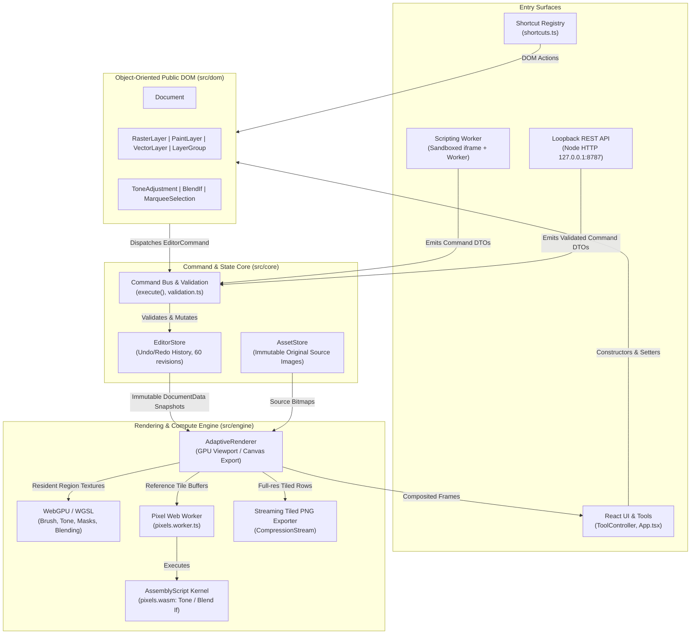

# Canoli Studio System Design & Architecture Specification

## SVG clipping invariant

Compile inert XML references without altering the source tree. Child silhouettes union independently of paint opacity/strokes; nested geometric clipping intersects. Bbox coordinates cannot replace the definition viewport used for percentage lengths. Preserve root viewport and use-instance coordinate planes, and retain independent native mask ownership rather than shared XML references. Host image/text preparation cannot overwrite outer clipping. Existing mask validation/history/cache and source leases remain authoritative. Hard vector masks retain geometric SVG output; richer alpha graphs remain explicit. See [SVG_CLIPPING.md](SVG_CLIPPING.md).

## Clipping invariant

Sibling clipping derives from current order, not ID links or mutated pixels. Resolve it independently in each group; orphan members contribute no pixels. Keep intrinsic base alpha separate from fill/color and apply it once after member composition. Base masks/styles and common opacity/blending stay on the completed stack. Cache keys cannot treat completed clipping as raw base-only content. Source-isolated preparation clears only its private outer flag, retaining the public relationship on replacement output. No new command authority, external capability or source-size cap is introduced. See [CLIPPING_MASKS.md](CLIPPING_MASKS.md).

Private bounded rendering must retain its captured clipping-member/backdrop mode through recursion. Re-resolving a single captured member as a new orphan loses valid artwork; changing its authored flag would corrupt the public relationship. Child group scopes still resolve independently.

## Photoshop clipping boundary

Retain supported sibling pixel membership in PSD/PSB records while rendering complete individual member planes from private snapshots with only their outer clipping flag cleared. Native mutable state and originals remain untouched. Inspect Photoshop grouped-clipping/knockout settings and sibling base eligibility before layered admission; unsupported semantics use the actual merged image, never an inferred native approximation. Renderer-free exports reject clipping. Group/advanced-style/Fill and broader native interchange remain separate gates. See [the supported subset](CLIPPING_MASKS.md#editable-photoshop-clipping-subset).

## Vector cache and sampling invariant

Retain conservative native geometric coverage independently of placement and allocation. Only a fully registry-owned immutable path array can key reusable footprint metadata; never trust caller freezing or stored IDs, and return owned rectangles. Compact working/cache rectangles must preserve the exact output-pixel lattice, canonical native-cell rasterization, mask coordinates and shadow support. Retention continues to share the established byte/entry budget. Pixel equivalence, model/Undo/source preservation and actual matching production frames are required; a small retained-byte count or a green functional suite does not prove all-tool responsiveness.

## Spacing feedback invariant

Measure gaps from the final authored preview after snap correction, affine conversion and clamping. Cache stationary geometry only for the captured owner/revision/selection. Existing anchors win attraction ties; equal-gap corrections retain final orthogonal overlap. Transient feedback/settings do not enter document commands, source data, persistence or exports. Movement still uses shared commands and one Undo, and replacement owners invalidate gestures even when persistent IDs/revisions match. See [LAYER_ALIGNMENT.md](LAYER_ALIGNMENT.md#spacing-feedback-while-moving-artwork).

## Declared alignment inspection (A12)

Design checks now accept optional explicit alignment rules against a canvas or independent key-layer frame, with document-pixel tolerance. Shared authored geometry includes affine parents, path/vertical text origins and active wet-paint/raster-replacement extents. Locked references remain readable; hidden targets, empty/unknown geometry and unresolved numerical precision remain explicit unverified results. Geometry work stays in private workers with scoped metadata and existing read/asset grants. Inspection changes no artwork/history or source bytes.

Omitted alignment policies retain strict version-1 reports; explicit policies use version 2 with measured evidence and complete matched/mismatched/unavailable/excluded coverage. The custom dialog exposes reviewable rules, stale-result protection, download/navigation and document-instance binding. Document schema 47 and existing native project/workspace/permission contracts are unchanged. Inferred alignment intent, bleed, rendered visibility, contrast/legibility and broader A12/roadmap gates remain required. See [DESIGN_CHECKS.md](DESIGN_CHECKS.md) for signatures, defaults, errors, limits and the dated verification boundary.

## Public vertical text (F08)

Schema 47 adds optional TextLayer `writingMode` (`horizontal-tb`, `vertical-rl`, `vertical-lr`) and `textOrientation` (`mixed`, `upright`, `sideways`). Shared OO setters/commands, reusable paragraph formats and awaited native preparation retain logical Unicode and character/font ownership. Vertical wrapping uses the existing logical `wrapWidth` as physical height. Derived `textFrameOrigin` and `textInlineExtent` separate the physical frame from its logical alignment extent; client patches cannot author these caches. Native paths retain their separate `textPathOrigin`. Defaults preserve legacy horizontal rendering; text that has entered native writing retains its native character-layout marker when switched back to horizontal.

The custom Inspector exposes writing direction, glyph orientation, paragraph height and vertical alignment. Corner resizing follows the inline axis and keeps the opposite frame corner under affine parents. Native projects/workspace/recipes preserve source text, geometry and complete original font/image payloads. Supported native SVG output/reimport retains writing/orientation and whole-line placement; unsupported inline writing/baseline graphs require explicit flattening. Independent REST sessions preserve the fields with estimated headless bounds; they do not synchronize with the browser. See [VERTICAL_TEXT.md](VERTICAL_TEXT.md) for the precise contract, limitations and dated verification status. Broader typography/interchange/device/performance and the original roadmap remain open.

## Vertical native-layout invariant

Native glyph advances and substitutions precede physical column placement and affine raster windows. Writing settings and logical spans are owned snapshots; no glyph-by-glyph rotation substitutes for shaping. Keep physical frame origin, source order, paragraph breaks and complete font originals independent. Unsupported native capability and cancelled/stale work publish no document/history mutation. The private dependency serves public schema-47 OO/command authoring without becoming an alternative mutation or plugin privilege. See [VERTICAL_TEXT.md](VERTICAL_TEXT.md).

## Editable baseline invariant

Authored curve coordinates must not drift when text/font metrics change. Retain native frame origin separately, derive it through shared commands, and apply it to interaction geometry rather than translating the baseline. Measure the actual native textPath, preserve logical source order and pin owned fonts through bitmap/export work. Worker/native/REST surfaces share structural validation and history while headless metrics remain explicit estimates. Inert SVG inspection keeps curves outside placeholder text until private source preparation. See [TEXT_PATHS.md](TEXT_PATHS.md).

## Baseline pointer authority

A text-baseline pointer gesture owns a detached curve draft, captured document/revision/selection and affine inverse. Preview commands must not mutate authored state or history. Recheck authority before queued publication and final shared OO commit; do not retarget an edit after selection, revision or owner changes. A click/no displacement retains asymmetric handles. Closed seams, text/fonts/offsets and layer placement survive anchor edits; explicit removal preserves valid minimum geometry. Screen-sized controls and hit testing follow the complete parent basis, including reflection/shear. See [TEXT_PATHS.md](TEXT_PATHS.md).

## Native curve ownership

Path preparation must preserve cubic geometry, logical Unicode ordering, whole-span shaping and font ownership independently. Accept numeric vector anchors rather than arbitrary SVG/URLs; snapshot before awaits, keep private fragment identities, validate native finite nonzero path length and clean up on cancellation/source/probe/image/bitmap failure. Reverse geometry and handles while keeping the closed seam. Allocation windows stay separate from document/source dimensions. The preparation DTO stays internal; current public authoring/transport and remaining gates are documented in [TEXT_PATHS.md](TEXT_PATHS.md). See [STYLED_TEXT.md](STYLED_TEXT.md#native-curve-preparation-internal-f08-dependency).

## Styled SVG admission invariant

Inert inspection cannot publish unresolved character-family aliases into the public model or install native faces. Validate private range metadata against its exact placeholder text and owner. Resolve every effective face and declare it before applying character commands; use native common baselines/anchors rather than estimates. Keep temporary native registration inside synchronous reconstruction with no callbacks/awaits, and dispose provisional stores after any failure. Publish only a complete revision-zero document; retain complete source bytes and report unrepresented graphs explicitly. See [SVG_CHARACTER_IMPORT.md](SVG_CHARACTER_IMPORT.md).

## Character-range invariant

Store literal text with ordered nonoverlapping sparse UTF-16 overrides. Normalize into mutable command drafts before immutable store reconciliation. Gaps inherit paragraph defaults; source edits retain unaffected ranges and explicit affinity. Inspector edits use actual beforeinput intervals for repeated text. Schema 45 gates even explicit empty arrays, which keep native paragraph layout. Capture typography/source/revision before awaits, retain owned fonts, validate throughout and release probes/leases/URLs. Scoped prepared bounds never enter serialized commands or bypass final host remeasurement/grants. Distinguish headless estimates from native host metrics. See [CHARACTER_TEXT.md](CHARACTER_TEXT.md) for the contract, limits and dated verification status.

## Styled text preparation boundary

Snapshot render DTOs before yielding; shape complete logical lines in the native SVG engine. Retain complete owned render fonts and source lifetimes, reject nontransferable web-font dependencies, and validate default native registrations throughout preparation. Native SVG metrics belong to SVG layout, not an assumed exact Canvas advance. Return only checked owned bitmaps; remove probes, revoke URLs and release sources on every failure, and close successful bitmaps on explicit release. The character-range integration now consumes this boundary. See [STYLED_TEXT.md](STYLED_TEXT.md).

Mixed-layout measurement requests must include original source offsets and consumed-break identity. Cache equal strings across positions only for the existing uniform-format path. Sync/async drivers share one line-breaking state machine; async work snapshots inputs, cooperates and rejects stale/cancelled/nonfinite results before publication. Preserve authored character formats when fitting derived word spacing. Retain font declarations and leases through asynchronous native paragraph/raster preparation; removed DOM probes must reject. The source-range helpers are immutable transformations consumed by shared OO commands and history.

## Variable-font ownership invariant

An authored axis tuple selects its own native binary faces; no edit mutates another layer's FontFace. Cache private instances separately from public source registrations. Every native installation path, including staged recipe/component promotion, must carry selected native bytes matching the render payload size before publishing its entry. Retain exact operation instances before capture, protect original source ownership and validate unchanged native descriptors/registration. Evict only unpinned instances and remove all variants on last-owner deactivation. Do not expose binary buffers through the public model or isolated APIs. Explicit fields require schema 44 before normalization; actual native/static-reference, source/Undo/persistence and production acceptance remains required. See [FONT_VARIATIONS.md](FONT_VARIATIONS.md).

## Retained world-geometry invariant

Cache successful layer geometry only behind the model's recursive immutable registry, keyed by complete root identity and layer ID. Never infer safety from persisted IDs, shared child references or caller freezing. Return owned rectangles on every request, preserve fresh mutable-draft traversal and avoid negative-ID retention. Root replacement naturally invalidates parent/path/position results and history navigation reuses only the matching root. Action availability must inspect the current readonly root without a whole-document serialization; accepted edits still pass the authoritative shared command validator.

## Authored text measurement invariant

A non-layout `layer.update` must not replace retained text bounds with measurements from another font environment. The reducer tests explicit metric/content/layout property presence before reflow and resolves linked paragraph overrides only for format edits. Same-value explicit reflow remains supported; history navigation restores saved results without remeasurement. Independent REST, isolated commits, semantic replay and UI actions consume this shared behavior.

## Alignment invariant

Plan all selected-root translations from one immutable canvas-space snapshot, excluding duplicate descendants and the explicit stationary key. Validate moving locks, geometry, hierarchy independence and finite coordinates before mutation. Commit only positions through one shared command; never reflow text, modify source contents or move the key. Semantic recipes preserve reference intent across fresh document identities. See [LAYER_ALIGNMENT.md](LAYER_ALIGNMENT.md) for defaults, examples, errors and verification limits.

## SVG font-source admission invariant

Never use an embedded CSS alias as a substitute for source ownership. Parse inert CSS tokens, reject external/dynamic resources, validate whole originals and canonical face descriptors, remap chosen native identities and preserve full affine alphabetic placement. No newly registered face spans an await or progress callback. Failed/stale/cancelled work disposes provisional stores; only accepted revision-zero documents adopt sources. Report unrepresented character/CSS graphs before explicit flattening. See [SVG_FONT_IMPORT.md](SVG_FONT_IMPORT.md).

## Portable font source invariant

A font-bearing recipe must never substitute a family string for missing source ownership. Version its dependencies and font actions, retain complete originals and selected native payloads, validate source/hash/descriptor agreement and acquire independent destination leases before publication. Private preflight may register prepared native faces only during synchronous planning; no registration spans an await or user progress callback. Conditional/parameterized replay publishes only required declarations in one shared command transaction. Batch snapshots and editable recovery scenes retain their own source bytes. See [FONT_RECIPES.md](FONT_RECIPES.md).

## Font source lifetime

Use temporary source leases acquired before async publication, weak Document ownership bindings over complete retained history, and operation leases for native exports/wet sessions. Adopted records collect only after every live model/history/view reference and operation pin ends; explicit host preparation remains caller-owned until adopted. Cancelling one identical importer must not evict another. Source identity includes the store entry generation, so removal/reinstallation invalidates old captures. Prepare relinks outside transactions and atomically publish shared add/replace/remove commands with normal locks and history. Source loss rejects navigation before publication. Current schema/transport and isolation boundaries remain unchanged. See [FONT_FILES.md](FONT_FILES.md).

## Font-file binding (F08)

Document schema 43 supports separately owned font resources, shared FontFile commands, explicit trusted embedding and native-project 5/workspace persistence. Selected native fonts preload into isolated script workers before text construction; no font chooser, host store, credentials or network grant is exposed there. Portable recipe/package/batch transport is documented separately in [FONT_RECIPES.md](FONT_RECIPES.md). Broader font/viewer/device/mixed-source acceptance and professional typography remain open. See [the current font-file contract and limits](FONT_FILES.md). Earlier font-source sections below describe read-only inspection/preview; explicit embedding is a separate operation.

## Font-source ownership invariant

Font admission retains the exact immutable original Blob and derives a selected whole native face without subsetting. Validate source/derived digests, actual signatures, selected index and strict DTOs before returning unregistered native FontFaces. Serialized host jobs use fresh disposable parser workers; cancellation/timeout/disposal revokes publication and terminates parsing. Native loads cannot be forcibly stopped, and late results acquire no registration or document authority. Private preview registrations belong solely to the child FontFaceSet and are removed on replacement/unmount. This source-only foundation has no persistent font asset, model/history/schema mutation or isolated/plugin/REST capability. Full source binding/persistence remains required F08 work. See [FONT_SOURCES.md](FONT_SOURCES.md).

## Cold text allocation invariant

Eligible text uses fresh native ink bounds and the existing exact-grid bounded compositor before drawing, including plain text without shadows. Logical text dimensions cannot bound italic, RTL, combining or overlapping glyph ink. Invalid/unavailable native ink metrics preserve the full reference path. Allocation geometry is temporary viewport work; no authored/source dimensions or stored formats change. Cold, retained, replacement and Undo output must match `cache:false` pixels exactly. Working-area reduction does not establish latency or physical-device performance.

## Document font replacement invariant

Match complete authored family requests exactly across all owned stored scopes. Recompute based-on cached formats without converting inheritance to overrides; update existing explicit font overrides and reflow only changed text. Resolve effective text locks per owning scope and changed component dependencies through existing registry checks. Validation/lock/reflow failure before publication discards the complete command draft, including earlier changes; accepted observer failures retain accepted state. UI owner/revision and request-keyed availability remain separate from native source/model persistence; no schema, font binary or isolated authority change occurs. See FONT_MANAGEMENT.md.

## Immutable query ownership

Retained layer lookup and inherited-lock metadata require the existing internal recursive-immutability proof. Object.freeze(root) alone is insufficient. Key the private weak index by the complete root, preserving ancestry across shared children, undo/redo, independent documents and previews. Mutable drafts always traverse current data; command validation and publication remain authoritative. Weak keys permit collection with their snapshots and retain no source blobs or decoder handles. Index metadata still consumes memory while snapshots remain reachable; no process-memory bound or full F14 claim follows. Public constructors, command/history/schema and isolated/REST permissions remain unchanged.

## Whole-line native font invariant

Capital variants and stretch are immutable authored font requests, never character replacement or layer scaling. Measurement/ink/layout/cache/render/export and resize capture use the same native state. Apply normal defaults to reused contexts, reject unsupported nondefault states before drawing, and include stretch in exact face-readiness matching. Normalize complete paragraph formats independently of sparse patch/override admission so absent values cannot create hidden overrides. Reject explicit new fields under old schema labels before normalization, including masters/history and style graphs. See [native font features](FONT_FEATURES.md).

## Multipage TIFF snapshot invariant

Capture the complete ordered page selection and all visible dependencies synchronously before user callbacks. Native rendering uses independent immutable page geometry and stores compressed bounded tiles; no page can silently substitute newer source/font generations. Selected owner closure/cancellation/callback failure invalidates the whole private result. Main-IFD offsets and metadata use the complete file budget, with exact 64-bit BigTIFF addressing where Classic overflows. Page selection is host/session identity, not persisted document-ID identity. Document/history and original bytes remain unchanged. See [multipage TIFF](TIFF_PAGES.md).

## Operation observation invariants

Provenance describes accepted result states, not replayable code or inferred authorship. Point maps move with snapshots and preserve current/fork/tip/comparison identity; missing records remain null. Only trusted ingress assigns source, IDs and local acceptance time. Weak runtime observation is never serialized, and imports are structurally checked stored claims. History 4 validates alignment/document ownership/repeated-ID result consistency before installing sources. Guard reentrant publication, exhaust observer delivery and preserve accepted generated assets/recipe success on observer failure. Authentication, signed/append-only audit, billing and inference remain separate. See HISTORY.md.

## Pinned comparison invariants

A saved comparison resolves both selectors synchronously to immutable accepted snapshots. Names/region are revisioned metadata, never fake artwork transitions; pruning or branch deletion cannot retarget them. History-3 admission validates all models/IDs/names/regions and complete source closure before session installation. Private previews use one common regional grid, clip each original canvas and compare displayed premultiplied sRGB8/alpha with bounded allocation and yielded cancellation checks. Continuing a pinned side preserves the old route, creates a new branch with an empty path, filters selection and invalidates recording/pending work. No decoder/model replay or headless/browser synchronization is introduced. Full provenance and broader quality/performance gates remain open. Exact contract: HISTORY.md.

## Persistent branch invariants

Branch tips represent the latest accepted result, independently of the undo cursor. Editing before that result forks and preserves both routes. Store-owned IDs, acyclic parents and exact fork snapshots survive per-route pruning. History-2 admission verifies every model and active-tip consistency before publication; native source closure includes all graph states. OO host/REST branch management is guarded and revisioned, while isolated branch mutation is forbidden. Alternate-route switches invalidate recorder state and pending previews/jobs; they never replay operations. Broader authenticated provenance and W05 work remain open. See [HISTORY.md](HISTORY.md).

## Atomic retained-history publication

All published and initial state containers, history entries and selected-ID arrays are deeply immutable; non-string transaction labels reject before callbacks or history publication. A history move publishes one accepted snapshot and reorders existing past/future transitions, preserving source closure and offline replay. Revision/canvas invalidation are per publication, not model/job re-execution. Reentrant model writes reject during navigation; observer errors cannot reverse accepted state or skip remaining notifications. Recipe direction notifications account for every crossed transition after publication. Private bounded reference previews lease historical source assets and are invalidated by document/lifetime/revision changes. Metadata reports disclose clipping, omitted records and incomplete comparisons; geometry is not a pixel diff or provenance. Existing history/project/workspace schemas remain unchanged. REST stays headless and Scripts cannot navigate inside atomic execution. See HISTORY.md.

## Palette storage boundary

Reusable palettes use a distinct lazy local IndexedDB repository with strict data-only pack validation and atomic writes. Durable per-entry revisions and catalog generations govern concurrent edits/imports; BroadcastChannel is advisory. App-owned picker requests pin the document/revision/selected layer and delegate a copied six-digit sRGB value to the original validated control callback. Palette management is outside document snapshots/history, accounts, independent headless REST and isolated plugin grants. Removing palette records leaves accepted colors intact. Complete schema, failure and supported-format boundaries: COLOR_PALETTES.md.

## Reusable artwork publication invariant

An artwork library entry is metadata plus a checksummed native project, separate from any live document/account. Capture only selected roots/reachable dependencies, never unrelated document history. Preparation pins a durable library epoch. The final model transaction runs synchronously inside a database read guard that validates entry revision/content and epoch, ordering placement against cross-tab edit/remove/clear. Revalidate destination revision/session/lifetime and abort immediately before dispatch. Transfer source ownership before publication and roll back unpublished assets on failure; once dispatch advances the revision, retain accepted sources even if a listener/acknowledgement throws. Library cleanup must not collect placed/undo assets. Package installation remains inert, atomic and outside isolated capabilities.

## Website identity and document authority — local signed-fixture workflow verified

Account export captures only owner metadata in one SQL snapshot. Deletion requires exact typed confirmation, current CSRF/origin and verification within five minutes by an already linked identity. One SQL commit removes the account and all sessions/links/proposals; short-lived identity hashes plus a database-ordered sequence reject old anonymous callbacks across instances/restarts, even within the same millisecond. Fresh later attempts may explicitly create a new account ID. Schema-1 migration is rollback-safe and grants old sessions no recent verification. Logical deletion does not erase SQLite pages/WAL/backups or local artwork. See SIGN_IN_WITH_CHATGPT.md for expiry and HTTP errors.

Identity is a separate optional application boundary. Verified issuer/client/subject resolves accounts; an email match is never account ownership. The durable private SQLite store atomically consumes browser-bound state and confirms identity links, rotates opaque session cookies and rejects cancelled/closed/expired generations after asynchronous token exchange. Source artwork, command history and local document/plugin grants do not live in this store. The optional same-origin static/auth host remains separate from the independent loopback REST service. Only identity scopes are requested; no plan/inference access is implied. See [the current contract and remaining live-provider acceptance](SIGN_IN_WITH_CHATGPT.md).

## Local MCP authority and commit receipts — local workflow verified

A browser user must choose the exact DocumentSession and grants before the local MCP process can inspect or edit it. A short-lived pairing request is not an owner credential. Pin the browser origin, validate loopback Host and require a separate private bearer on owner routes. Original source files and credentials never become tool data. Serialize typed metadata only; parse commands and pin all referenced assets before the same OO command/history boundary. Reject changed revisions, closed/replaced sessions, revoked grants and active canvas gestures at the final commit check. Cancellation before broker commit authorization prevents execution; after authorization an acknowledgement can be unknown, so retain the request receipt and never automatically retry it as new work. A late acknowledgement resolves that same receipt. Do not evict mutation receipts while continuing to accept old keys. Disconnect preserves already accepted artwork/history. Pairing cancellation invalidates late or half-acknowledged grants. This opt-in live-browser path does not synchronize independent REST sessions or extend isolated script privileges. See [protocol/lifecycle limits](CHATGPT_PLUGIN.md); real ChatGPT client acceptance remains required.

## Local calibrated catalog publication — supported local workflow

Original XML and its descriptor publish in one IndexedDB transaction after private parsing/hash validation; compiled profiles are never independently persisted. Imports/reviews capture a durable generation, and removal/clear advances it so a late preparation cannot reinstall deleted data or select a replacement resource. Cancellation/disposal abort workers and transactions before publication; an already completed storage commit remains acknowledged. Catalog corruption produces an unavailable recoverable row, never a usable partial profile or automatic deletion. Optional library access is lazy, so storage denial cannot prevent editor construction/manual development. Only an explicit reviewed immutable snapshot enters RAW settings; native validation and shared command/undo/source ownership remain authoritative. Camera crop, lens calibration crop, recorded equivalent focal length and viewport geometry are distinct. Precise host/API limits are in SCRIPTING_API.md; broad model/photographic/full-roadmap acceptance remains open.

## Calibrated RAW profile invariant — in implementation

Native project files with explicit retained history use the shared validated restoration constructor when opened, just like workspace records. Loading must not discard already verified undo/redo artwork; failed construction releases prepared assets before session publication. History-free files remain clean snapshots.

Supported complete Lensfun calibration snapshots are immutable settings values, separate from manual coefficients. Only disposable private RAW workers own the native modifier. Geometry admission precedes demosaicing; source-position float32 gains precede bilinear sampling and one final RGB16 quantization/sRGB8 transfer. Absolute pixel callbacks prevent partition-dependent scanline drift, while bounded coordinate jobs and source/gain tiles remain independent of original geometry. Enabled profiles require separate lens-native provenance; disabled profiles load no lens native dependency. Shared host commands preserve original/accepted assets, locks, revision/grant validation, one-step history and catalog/decoder-independent accepted reopening. Source calibration declarations are not proof of physical quality. The supported trusted XML/library and explicit matching/review workflow above is verified; wider photographic/model and roadmap gates remain unfinished. Precise contracts are in SCRIPTING_API.md.

## RAW development workflow in implementation

Trusted `editor.inspectRaw(file, image = 0, control = {})` performs read-only native sensor preflight. It returns the version-1 camera/decoder, sensor/visible/display geometry, selected-image/count, precision, calibration/white-balance, extra-sample and warning/capability report. It changes no document, assets or history. Controls accept AbortSignal and progress with phases inspecting/developing/encoding and a nullable fraction. Inspection needs the local native worker and full-input buffer; queued inspections/development share one application-context lease. Native failure, malformed results, cancellation and throwing callbacks reject and terminate private work.

The internal checked decoder produces owned linear RGB16/grayscale16; explicit conversion consent is required before the private worker returns an sRGB RGBA8 working PNG. The build omits DNG SDK/RawSpeed/external lossy-JPEG DNG and external ICC-file processing. Reported metadata support is not proof of valid sensor payloads, device memory or photographic fidelity. The connected host workflow now retains original/accepted assets, editable master commands, persistence and review/development controls; automated acceptance and remaining gates are recorded in the dated implementation roadmap. See the connected RAW source-ownership section below. Isolated Scripts/plugins develop only installed RAW sources through current document/assets grants; file opening stays a trusted host service. Separate headless REST file transport/operations are explicit and do not synchronize browser sessions.

## AVIF application import and original-source invariant

AVIF input uses its own primary-item/property-association reader; the strict owned-output validator remains separate. Trusted preflight is read-only. Metadata work has explicit box/table/profile budgets, independent of encoded file size and native image geometry. Internal private workers check high-bit-depth/color-assumption consent before loading the local decoder, validate raw dimensions and return crop/orientation-correct PNG with source ICC identification. Success, failure, throwing callbacks and abort terminate the worker; cancellation remains effective during host result validation. The owned C ABI checks native errors and actual source depth/alpha/CICP before publication. Its pinned libavif 1.3/AOM 3.12 build removes optional default geometry guards while retaining native overflow/allocation checks and a pre-decode PTRDIFF representation check. Full decoded codec memory and real codec/browser limits are explicit; this is not region decoding, an HDR pipeline or a performance acceptance claim.

AVIF application opening privately stages an OO Document/RasterLayer and an AssetStore; publication requires the captured revision/session/lifetime and I/O generation. Human edits, superseding opens, cancellation or disposal reject without installing prepared assets. A serial decode lease admits no worker or full plane for queued requests. Preserve exact original AVIF bytes and normalized precision/color choices through project/workspace/recovery/recipe/brush storage and every copy/remap path; the crop/orientation-correct bitmap is derived editing data. Recovery identities include those choices. A derived frozen capability report is reconstructed on decode. Metadata acceptance does not prove a valid native payload, sufficient memory or broad F10/F11/F14 completion. No new isolated Scripts/plugin/REST file privilege or browser/headless synchronization is implied. Sources: [AVIF specification](https://aomediacodec.github.io/av1-avif/v1.2.0.html), [owned wrapper/build](../scripts/avif-decoder/README.md) and [libavif 1.3 API](https://github.com/AOMediaCodec/libavif/blob/v1.3.0/include/avif/avif.h). Exact source revisions, build inputs, artifact identities and real native/WASM decoding tests determine release evidence.

Before generic browser decoding, a bounded top-level box/brand scan rejects AVIF bytes declared as PNG/JPEG/WebP/TIFF. This prevents MIME relabeling from bypassing precision/color review; it is routing protection, not proof of a valid AV1 payload. The scan reads box headers and at most the 4 KiB file-type table, skipping compressed image payloads, with the same 16,384-box metadata budget as inspection.

## Recovery failure propagation invariant

An exception during synchronous request setup or an IndexedDB callback must abort the complete checkpoint/asset write, preserve its original cause and retain prior committed data. Only transaction completion permits saved acknowledgement. UI and worker persistence share this boundary. Active-document status, focused edits, native output, undo state, error-over-download priority and the closure flush contract remain unchanged.

Optional local recent-file initialization contains denied storage capability access. Notification failures never change the result of an already committed record/remove/clear transaction. Durable generation checks provide invalidation without a working notification channel. These corrections do not establish complete durability or sustained performance acceptance.

## Recent-file persistence and delivery invariant

A successful document open/import is independent of its optional background recent-file copy. Only committed, validated entry/blob transactions may appear as persisted copies. Capture retains immutable original file bytes, not viewport images; hashing uses private bounded reads and a separate worker. A single serial queue and the twenty-pending policy bound owned active/queued preparations without changing image/file import geometry. Cross-tab remove/clear advances a durable generation checked at commit, preventing older prepared copies from reappearing. Metadata corruption cannot authorize opening; size and SHA-256 are verified before a File is delivered. Once delivered, that independent immutable file and any opened assets survive recent-list removal.

Resource-aware command search keys open sessions and recent copies by identity. Async updates preserve that identity or leave no active result until navigation; Enter must not target an unrelated replacement. Recent raster opening stages a complete constructor-validated document privately, then checks current owner/revision/lifetime/disposal before replacement. All original project/format preflight, shared command/history and script/plugin isolation rules remain authoritative. Local copies provide neither live filesystem links nor cloud backup, and functional acceptance does not establish universal performance/device/memory guarantees.

## Workspace preference publication invariant

Workspace layout is local UI state, outside the document/model/history and binary workspace graph. Strictly validate the complete current/named layout envelope, then perform one successful preference write before changing the displayed arrangement. Keep legacy width bytes read-only and let explicit new responsive defaults override them. Detected stale external values and storage failures reject without optimistic publication; explicit reload can discard the settings draft. This comparison does not promise atomic simultaneous cross-tab writes. Fit only visible docks, retaining preferred widths across viewport-only changes. Stable keyed DOM slots preserve canvas/panel state while actual focus order follows the chosen sides/order; the rail must always provide recovery. No source assets, project schemas, rendering coordinates, commands, isolated scripting permissions or REST sessions are changed.

## AVIF delivery ownership

The trusted browser export and batch paths use one local single-thread AVIF WASM worker per admitted capture. Canonical native tiles feed an export-owned full RGBA8 plane; only that private buffer transfers. A FIFO application-context lease bounds simultaneous full-frame/codec jobs without limiting document/import resolution. The host pins relevant sources/fonts before yielding, watches their lifetime during encoding, validates returned still-image metadata and terminates the worker on every outcome. Cancellation rejects before publication; ordinary edits continue against the live OO document while output retains its immutable snapshot. Batch geometry is fitted independently of the pinned source document. Native allocation, codec memory and reader support remain real limits. No schema, cloud, REST synchronization or isolated plugin/file privilege is added. [AVIF contract](SCRIPTING_API.md#avif-export-trusted-application-code).

## Paragraph style resolution invariant

A text binding refers to exactly one style in its owning document and stores explicit per-field overrides. Concrete text fields must equal the complete base plus overrides under canonical typography defaults. Only shared commands may change an attached binding, base or override; every affected frame reflows through existing native measurement. Root style edits do not cross into embedded document scopes. Converting/copying artwork preserves or remaps its required definitions; no visual dependency may dangle after persistence or transfer. Detachment/deletion preserves resolved typography. Changed effective followers and binding mutations obey locks, and a rejected operation publishes no partial library/geometry/history. Style metadata requires schema 40 in root/embedded documents. Rendering consumes the validated concrete fields, and SVG reports relationship loss instead of advertising portable linked styles.

## Bilateral source and finite-support invariant

Bilateral denoise reads only original native neighbors in a finite square aperture. Its spatial sigma is radius/2 and its color sigma is encoded RGB root-mean-square distance. Coverage weights exclude hidden transparent RGB; normalization precedes strength interpolation and final byte rounding. Every output alpha and hidden zero-alpha pixel is copied from the center. No intermediate separable approximation or evolving output is sampled. Per-worker range/spatial caches retain at most 1560608/8712 bytes, independent of original geometry; callers and WASM receive private copies. Three explicit zero settings bypass resampling and SVG rasterization. Enabled native support remains additive across the filter stack. Root and embedded-master records require schema 39; all mutations use existing shared commands/undo/revisions/assets/isolation, with separate REST sessions.

## Median rank and source invariant

Median denoise reads immutable native master RGBA. Each output channel is the lower alpha-weighted median of its finite square neighborhood; coverage and zero-alpha hidden RGB are copied exactly from the center. No source asset is rewritten, downsampled or replaced. Histograms slide over original samples, never previously filtered output. Cumulative support is additive across enabled filters; disabled/zero-radius entries are inert. Native crops include full support and transparent artboard padding, so retained and uncached tile interiors agree with whole-image processing. The fixed histogram workspace is 3096 bytes plus private input/output. Median data requires schema 38 at both root and embedded-master boundaries. UI/OO/REST/scripts use existing commands and ownership/undo, without new isolated privileges or browser/REST synchronization.

## Large bitmap precision and ownership invariant

A source bitmap's full geometry survives precision fallback. Recover native premultiplied bytes through bounded patch reads; choose numerical sampling from projected-coordinate precision, without limiting or resizing originals. Preserve axis-aligned half-pixel ties and integrate affine support in the output pixel plane. Only one numerical reader is active per texture batch; its 64 native 64×64 entries are bounded independently of source dimensions. Share a task deadline across captures and reject clear/disposal/source changes before worker conversion/publication. Cache retirement cannot cancel independent reads. Mutable native canvases are snapshotted once, private copies close exactly once, and original ImageBitmaps remain borrowed. Source identities participate in retained bitmap-mask keys. Renderer/schema/history/isolation contracts remain unchanged; memory and latency claims require separate measured evidence.

## Native raster work partition invariant

Rectangular frequency sampling may reduce requests only without increasing estimated halo work. Include both nested composition projection margins before selecting a preferred 1,000,000-pixel job; retain existing native-source/placement eligibility, 256/512/1024 fallbacks and the 4 MP/8192-edge allocation checks. Independent Linear Light/Burn partitions retain the previous 1,048,576-pixel budget and 8192 working edges. Awaited work rechecks cancellation before publication. No working-grid choice changes original geometry, pixel equations, assets, OO mutation/history, persistent schemas or isolation.

## Ordinary paint crop and retained-buffer invariant

Untextured coverage on the same output-pixel lattice must be independent of viewport/export crop boundaries. Canonical native cells retain complete contributing primitives; oversized projected geometry uses bounded numerical pixel coverage. Preserve original sample indices, pressure, tilt, copy order and source geometry. Apply selection and whole-stroke opacity after raw stamp accumulation. Opaque shortcuts require certified complete pixels and identical destination bytes, rather than approximate edge coverage.

Accepted active prefixes own mutable inputs. Yielded extensions stay private until current-generation publication; cancellation preserves a reusable accepted prefix and releases failed stages. One task deadline spans consecutive numerical primitives as well as pixel blocks. Every retained native padding surface counts toward the mask LRU alongside the raw viewport, including size changes at an existing key. Working-surface budgets never become authored image or geometry limits. Logical owned-buffer checks do not establish browser process-memory or physical-display acceptance.

Normalize lattice indices only when an integral projected coordinate round-trips exactly through its inverse scale; preserve genuinely fractional origins. Retention epochs do not cancel independent reads. A busy mask-cache producer owns an exclusive lease: a second reader uses private work, and eviction/cache clearing retires the owner until its lease releases. Explicit caller cancellation still stops work and prevents partial publication.

## Shared native frequency radius and preview ownership — schema 37

A group radius is a parent parameter, not a rewrite of locked band records. The nearest explicit finite value controls descendant native frequency filters in the same document plane; null inherits and component entry resets scope. Resolver-derived sigma never mutates serialized fallback values. Preserve effective scope when extracting artwork for rasterization, conversion, isolated Photoshop output or another document. LayerGroup commands enforce group/ancestor locks, field age and atomic history normally.

One private captured source supports all dialog previews and final commit. A preview owns its bounded native crop/halo, worker copies and output canvases; obsolete/aborted work cannot publish a frame. Returned frames survive preparation disposal until explicitly released. The UI has one active preview request and coalesces pending choices. Commit uses a fresh model plus source/selection/revision/lifetime checks and only installs its original-resolution capture after render preflight. Failure must retain the base or dispose it safely, never publish partial layers/assets. Real native/50MP/cache/performance and full-roadmap gates remain open until measured.

An exact render shortcut may replace only structurally canonical, unchanged native regions with their captured raster. Retouch intersections and any changed filter/mask/geometry/source settings preserve full decomposition. Effective-radius and working-budget checks precede elision. Per-render Gaussian/original sharing is bounded to 8 MiB and never survives the render; source signatures and native prefixes distinguish cache inputs. Filter-mask mixing always retains the correct original pixels. Shared recursive task checkpoints and PNG tile boundaries yield for input/cancellation without reducing native output resolution or discarding edits.

## Frequency reconstruction and phase invariants — introduced in schema 36

Native captured O and rounded Gaussian L define opaque high H=round(127.5+(O−L)/2). Linear Light produces clamp(L+2H−255); a protected Linear Burn plane subtracts its single lost rounding bit, preserving exact native RGB8 before source alpha and affine resampling. Low/high/correction must derive from the same source and radius. Bands remain independently retouchable; original source records/bytes are never overwritten. Native composition must sample the real image-frame edge rather than transparent padded tile edges.

Preserve original raster ordering: document-pixel tone before ordinary erasures; active wet reconstruction owns its entire native sequence and expanded bounds. Raster-erasure mask records retain captured operation dimensions and source texture references. Post-placement document-tone filters must trail native filters; their mask coverage is feathered natively then projected, with inversion/density applied at mixing. Worker interfaces snapshot owned inputs and validate result types/extents. Preparation leases immutable source identities, rejects stale/cancelled work and commits once through shared commands. Cache keys include reachable-master dependencies and radius/prefix geometry; unrelated edits must not invalidate immutable captured-source low planes. Project/workspace remain 3/2. Native/50MP/interchange/automation and performance gates are still being verified; no whole-roadmap completion follows from this invariant.

## Red-eye correction invariant

Selection-masked pupil correction is an ordinary parametric adjustment, with a strict schema-35 record and immutable public constructor. UI captures document-space selection in the inserted layer's local plane atomically; scripts/REST may explicitly supply normal masks. Native WASM and GPU WGSL implement the documented straight-RGB8 red-excess predicate, modify only red, and preserve alpha. Worker calls snapshot inputs before readiness, validate returned type/extent and preserve caller ownership. Mask, opacity, affine placement, revision, lock, history and source-asset invariants remain shared. Working tiles do not cap source geometry. This local manual operation introduces no semantic detection, provider calls, cloud privileges or REST/browser synchronization.

## Prepared prefix epoch, storage and frame invariant — functional acceptance; latency open

Matching same-session native epochs permit reuse of prepared pixels. Captured hints plus new projections must cover exactly the complete current output; omit cells reverted to original pixels. Ordinary snapshots/finish remain complete and independently owned. Each view owns its leases independently of the adapter's separate current-output ownership. Replacing/discarding prepared output must not close resources held by older frames, renderer preparation or committed assets. Check active processing storage even on no-read reuse paths, then transfer final storage/result ownership explicitly. Full source/revision/native alpha checks precede one OO commit. Failure publishes no host edits/assets and clears private work. Output memory is workload dependent, sharing bitmaps with views; no source cap is introduced.

A stable wet owner shares the existing preparation frame boundary, avoiding an extra wait after asynchronous preparation while preserving one start per owner/frame boundary. Obsolete source/view/font/backend work remains cancelled and retained frame resources release independently. Actual main build/unit/native checks pass; its 51 non-documentation release files exactly match the isolated 82-workflow production runtime. [prefix evidence](benchmarks/brush-wet-prefix-reuse-2026-10-18.json) separates mixed continuous-pointer p95 from improved small-fixture release medians. Neither establishes33 ms, general60fps, sustained/device/process-memory or full-roadmap acceptance.

## Resident wet storage invariant — functional acceptance; performance gates open

Only a fresh, unused, exclusively claimed native store may defer unpublished working writes into the bounded cache. Capture caller arrays before asynchronous eviction. Commit dirty evictions atomically before advancing resident epochs, drop unreferenced unpublished scratch without I/O, and flush every referenced original/result before finish transfers its store/lock. Snapshots own independent native stores with paired original/result writes. Recheck source, cancellation, native method identity and storage lifetime around I/O; failures publish no host edits/assets. Explicit disposal drops unpublished memory. Custom/used/modified stores and zero-cache operation preserve write-through semantics.

Actual main build/unit/native acceptance and byte-identical production runtime are recorded in [sealed evidence](benchmarks/brush-wet-resident-cache-2026-10-18.json). Three clean paired runs preserve exact pixels, source/project operations and undo. Observed median per-run p95 improves to 88.1–119.7 ms, still above 33 ms for every fixture. No source geometry cap, public mutation bypass, isolated privilege, REST/browser sync or gesture durability guarantee is introduced. Full F06/F14, sustained/device/process-memory and the complete original roadmap remain open.

## Native wet working-set invariant — functional acceptance

Keep complete original backing cells independently of numerical working regions. Crop reservoir sampling, native coverage and worker transfers only to the cell/support/halo intersection while preserving global pixel centers, native raster grid, summation order and destination bytes outside support. Commit paired private planes and superseded destinations before advancing resident cache state. Earlier reservoir epochs remain readable until all dab cells are staged; bound cleanup groups and check cancellation without source-geometry limits. Custom storage fallback, private snapshot ownership, host validation, one shared undo and schema34/project3/workspace2 stay unchanged. The actual head and clean paired evidence are sealed in brush-wet-gesture-performance-2026-10-18.json. Every measured fixture still fails33ms, and sustained/device/process-memory gates remain open.

## Wet mask plane and commit invariant — implementation in verification

Mask operations preserve source geometry and reconstruct native raw alpha in order, before the full mask/world/master transform and mask-wide appearance. Coverage capture neutralizes enabled/inverted/density/feather and never samples rendered artwork or filter output. Private retained jobs, original asset leases, prefix/render ownership and source/revision guards are shared with layer wet authoring. LayerMask values serialize mode-tagged ordered operations under schema34; root/history/embedded age checks, central asset remapping and shared command discovery protect every external commit. Strict prepared-alpha validation precedes atomic scripts and independent REST transactions. Working ROI/cache budgets do not limit source resolution. Whole-process/device and sustained-throughput acceptance remain open.

## Wet gesture resource boundary — in verification

The pointer tools and trusted one-shot authoring share a retained native job with private original-source leases, immutable prefix documents and privately decoded output PNGs. Prefix assets have separate creator/render leases; obsolete queued and finished jobs release their references. Host source/revision/lifetime checks guard preparation and presentation. Final numeric workspace cleanup and prepared alpha validation precede one synchronous shared transaction, with collision checks and exact-owner rollback. Every accepted sample is retained; only preview publication is coalesced. Default memory/cache budgets do not restrict original image resolution. Mask/filter-mask coverage extends this boundary as described above; sustained/device acceptance remains unfinished; no new isolated capability, REST/browser synchronization, provider call or upload is introduced.

Retained wet workspaces serialize append/snapshot/finish operations over captured settings and immutable newly accepted samples. Each symmetry carrier and native canvas epoch advances only after a complete dab. Later prefixes reuse completed native work. Snapshot cropping never crops transport; selection/whole-opacity projections are cached per raw epoch and applied once. Result snapshots own independent private backing/locks and survive parent/source disposal. Finishing transfers job ownership only after canonical output and cleanup succeed. Abort or job failure publishes no command/asset; independent completed results remain owned. No new isolated service, REST synchronization or source-resolution cap is introduced. Tool/UI/preset/mask and full performance/device acceptance remain open.

Schema-33 prepared wet operations preserve ordered native pixel replacement before layer appearance. Output alpha is at most coverage alpha and is already masked; coverage removes destination alpha and output adds once. Whole-operation opacity envelopes all replacements once. Never mask already filtered output a second time or convert original rasters to paint layers. Source pixels and captured operation geometry survive resize/undo/persistence. Bounded native reconstruction precedes transforms; GPU falls back and SVG uses disclosed native prefixes. Async preparation/validation owns private resources and rechecks revision/session/selection/source identity before a synchronous OO commit. Scripts and REST share prepared-content validation within existing isolation/session boundaries. This adapter is in verification; gestures, incremental previews and full tool/preset/mask/performance gates remain open.

Native spatial wet preparation processes the complete recorded path before viewport cropping. Each symmetry copy owns a separate native spatial pigment field; copies sample completed preceding copies in shared dab order. Within one dab, all destination and carried reads use the same prior epoch. Complete private staging precedes advancement, and bilinear neighbors sum in a fixed order across backing partitions. Native coverage uses a fixed raster grid; final opacity/selection applies once and unchanged pixels remain byte-invariant. Disk-backed private jobs survive resident cache eviction, and active Web Locks prevent abandoned-job cleanup from deleting another tab/worker's state. Failed preparation publishes no model/assets and deletes its own namespace; completed output owns its bytes until disposal. The rendered-document sampler captures source/font identity and remains read-only. These are internal dependencies; authored ordered layer replacement, OO/history/persistence, tools/preview and export/automation integration remain unfinished. See ARCHITECTURE.md for defaults, bounds, cleanup fallback and current limits.

Wet paint currently has an internal numerical dependency, not a shipped mixer/smudge workflow. Captured pre-dab destination and spatial carried pigment are distinct immutable inputs. The worker executes actual WASM premultiplied RGBA transport and returns owned RGBA8 pixels plus Float32 reservoir state. Pickup samples pre-deposit pixels; each dab tile therefore has no dependency on the processing order of other tiles from that same dab. Zero flow/coverage is inert; alpha can increase or decrease. Initial load is finite; whole-stroke selection/opacity belongs to a later original/result composite. Caller data never transfers, and returned extents/normalized premultiplied channels are validated. Bounded working tiles must not become source/document limits. Full-stroke spatial transport, ordered layer mutations, captured sources, UI/cancel/history/persistence and export parity remain required before delivery; no new isolated host service or REST/browser synchronization is added. See ARCHITECTURE.md for the exact internal equations and defaults.

Pen overlay reconciliation retains every native control while memoizing long paths in contiguous 64-anchor blocks. A changed block refreshes its markers; unchanged blocks retain existing SVG nodes. Short paths render directly, and fragments preserve original SVG ancestry and paint order. Each block retains only its own at-most-64 point references, avoiding retention of complete prior path arrays across independent block updates. Basis, zoom, selection, geometry length/coordinates and the large-translation precision fallback remain invalidation inputs. This is a UI rendering optimization; public constructors, validation, history, persistence and isolated extension boundaries remain unchanged.

Native text spacing follows one shared state contract: OO text setters and strict commands validate schema-25 wordSpacing/fontKerning, then measurement, Canvas reference rendering, GPU reference textures and SVG preparation apply complete font/spacing/direction defaults. Whole lines stay in the browser shaping engine. Unsupported nondefault native controls reject explicitly; reset restores supported defaults in one command. Legacy valid roots/history migrate without inserting fields, and project/workspace/source asset boundaries stay unchanged. Schema-26 paragraph wrapping, gaps and indent share the native paragraph invariant below. Font substitution, headless estimated geometry and broader paragraph-style/variable-font/multilingual acceptance remain explicit limitations.

This document defines the system design, architectural boundaries, and non-negotiable invariants of Canoli Studio. All human contributors and AI coding agents working on this codebase must strictly adhere to these specifications.

---

## TIFF import invariant

TIFF/BigTIFF source identity includes original Blob bytes and selected page/precision-consent settings. The trusted inspector/decoder workers return validated reports and an intermediate PNG; the AssetStore retains original TIFF separately from its 8-bit bitmap. Native affine placement owns orientation, while revision/session/lifetime checks guard private staged publication. Project/workspace/recipe/copy/recovery must carry settings unchanged; recovery integrity keys include them, preserving existing non-TIFF hashes. No document schema, isolated file privilege, plugin permission or REST/browser synchronization is added. Decode streams rows rather than complete source strips, without claiming constant total memory or imposing arbitrary image limits. SCRIPTING_API.md defines the supported subset and explicit failures.

## 1. High-Level Architecture

PDF raster delivery is a trusted read-only export: pin immutable model/visible sources/fonts, render canonical native grid regions, stream compressed RGB/alpha rows and serialize one image/soft mask with physical DPI placement. A single image matrix avoids independent tile-edge rounding. Blob-backed objects use exact addressing and eight-byte cross-reference offsets; geometry failures and lifecycle/cancel errors publish no partial file. Surface/stream cleanup is required. Source/output/reader memory remains data dependent, and PDF prepress/editability/import/REST/batch are not implied. Generated sRGB/P3 output ICC uses the piecewise sRGB curve; original profiles, document precision/schema and extension privileges stay unchanged.

Canoli Studio is a browser-first, local-first image editor combining precision manual editing with future AI-assisted workflows. It decouples document representation, state mutation, image rendering, and execution surfaces.

---

## 2. Module Responsibilities & Boundaries

| Module                | Location                           | Responsibility & Rules                                                                                                                                                                   |
| :-------------------- | :--------------------------------- | :--------------------------------------------------------------------------------------------------------------------------------------------------------------------------------------- |
| **Public DOM**        | `src/dom/`                         | Public OOP constructors (`Document`, `RasterLayer`, `PaintLayer`, `VectorLayer`, `LayerGroup`, etc.). Browser-independent; wraps internal IDs; delegates attached mutations to commands. |
| **Core Model**        | `src/core/model.ts`, `drawing.ts`  | Plain, serializable Data Transfer Objects (DTOs) and structural schemas. Children are stored back-to-front. No UI state or pixel buffers.                                                |
| **Command Core**      | `src/core/commands.ts`, `store.ts` | Validated, atomic mutations and history management (undo/redo stack up to 60 revisions). Pure functions that transform document snapshots.                                               |
| **Validation**        | `src/core/validation.ts`           | Runtime schema validation (using Zod) for external commands and script results.                                                                                                          |
| **Asset Store**       | `src/core/assets.ts`               | Manages immutable original source images, small previews/thumbnails, and lifecycle cleanup.                                                                                              |
| **Persistence**       | `src/core/project.ts`              | Serializes/loads v2 `.luma` blob containers and legacy JSON. `src/core/recovery.ts` atomically persists local checkpoints/assets; see STORAGE_FORMAT.md.                                 |
| **Rendering Engine**  | `src/engine/`                      | Decoupled compositing pipeline (`DocumentRenderer`, `CanvasRenderer`), tile management, pixel worker communication, and streaming PNG export.                                            |
| **WASM Kernel**       | `assembly/pixels.ts`               | High-performance AssemblyScript pixel operations (exposure, contrast, saturation and Blend If math; Canvas 2D handles blend modes) compiled to `pixels.wasm`.                            |
| **Scripting Sandbox** | `src/scripting/`                   | Worker-based isolated JavaScript runtime inside an opaque-origin iframe. Sandboxed execution with a 5-second timeout.                                                                    |
| **REST API**          | `server/`                          | Local loopback prototype service (`127.0.0.1:8787`) using in-memory documents and revision-based conflict detection.                                                                     |
| **UI & Tools**        | `src/ui/`, `src/tools.ts`          | React UI, gesture controllers, tool settings, centralized keyboard shortcuts, custom dark theme tokens.                                                                                  |

---

## 3. Non-Negotiable System Invariants

### 1. Unified Object-Oriented DOM with Stable ID Indirection

- The public programming interface is strictly object-oriented.
- **Detached vs. Attached:** Constructors (`new RasterLayer(...)`) create detached instances. Adding a layer to a document or group attaches it.
- **Dynamic Handle Indirection:** Attached objects do not store mutable state in class fields. Instead, they store a stable `id` and read properties directly from the current document revision in `EditorStore`.
- **Handle Survival Across Undo/Redo:** Because handles resolve state by ID against the active revision, handles retained in code or UI remain valid after undo/redo cycles.

### 2. Pure Command-Driven Mutation & Synchronous Transactions

- **No Direct State Mutation:** Document trees and snapshots are strictly immutable outside commands. All UI gestures, shortcuts, scripting calls, and REST endpoints emit `EditorCommand` objects.
- **Transaction Atomicity:** Multi-operation edits run inside `Document.transaction(label, callback)`. A transaction groups all child commands into exactly **one** undo history entry.
- **Synchronous Only:** Transactions are strictly synchronous. Asynchronous work (e.g. decoding images, running worker jobs) must complete _before_ opening a transaction.

### 3. Asset Immutability & Decoupled Memory Budgets (No Fixed MP Limits)

- **Preserve Original Pixels:** Original imported images are immutable source assets in `AssetStore`. Edits, transforms, and adjustments never overwrite source data.
- **No Arbitrary Resolution Caps:** Never add arbitrary megapixel, image-byte, or dimension limits (e.g., no 8192px cutoff). Document dimensions are numeric coordinates in JavaScript safe-integer space.
- **Decoupled Allocations:**
  - Viewport renders visible document regions into preview surfaces (budgeted to $\le 4\text{ MP}$ / $4096\text{px}$).
  - Interactive layer/mask caches retain at most 64 MiB plus a 16 MiB active-stroke surface; painted-mask active coverage adds a separate bounded 16 MiB tile LRU. Cache eviction never changes source resolution. Export and clone tiles bypass viewport caching.
  - Pixel filters run on small tiles ($\le 1024 \times 1024$) in worker threads.
  - Full-resolution PNG export streams scanlines in bounded chunks ($\sim 4\text{ MB}$) directly through `CompressionStream('deflate')`.

### 4. Sandbox Isolation for Automation Surfaces

- **Scripting Security:** Scripts run off the UI thread in a Web Worker inside an opaque-origin sandboxed iframe. Network access, browser DOM, host objects (`window`, `fetch`), and raw pixel buffers are strictly blocked.
- **DTO Validation:** Scripts return command DTOs that are validated against strict Zod schemas before being applied as an atomic transaction.
- **REST Boundary:** The local REST server operates on separate in-memory documents and enforces concurrency via `expectedRevision`.

### 5. Multi-Threaded Engine & WASM Boundary

- **No Pixel Loops on Main Thread:** Pixel manipulation must run inside `src/engine/pixels.worker.ts`.
- **GPU path:** WebGPU/WGSL handles supported viewport pixel work; Canvas/WASM remains the export/reference and unsupported-device/effect fallback. Device loss must trigger a new fallback frame. GPU allocations never impose image import limits. See `ARCHITECTURE.md` for current shader scope, working budgets, tolerances and verification limits.
- **AssemblyScript vs. TypeScript:** AssemblyScript is a distinct, constrained language used exclusively for numerical pixel kernels (`assembly/pixels.ts`). General UI and business logic must remain in TypeScript.

### 6. Bespoke Design System & Centralized Shortcuts

- **No Third-Party Component Frameworks:** Do not introduce `shadcn`, Tailwind UI, or external widget libraries. Use the custom tokens in `src/ui/tokens.css` and custom components in `src/ui/controls.tsx` and `src/ui/Dialog.tsx`.
- **Central Shortcut Registry:** Keyboard binding definitions belong in `src/ui/shortcuts.ts`; the UI registers document-dependent actions against those definitions. Shortcuts must automatically suspend when text fields (`input`, `textarea`, `select`) have focus.

---

## 4. Agent Decision Matrix for Implementing Features

| Feature Type              | Required Implementation Path                                                                                                                                                                                                                              | Strict Prohibitions                                                                       |
| :------------------------ | :-------------------------------------------------------------------------------------------------------------------------------------------------------------------------------------------------------------------------------------------------------- | :---------------------------------------------------------------------------------------- |
| **New Interactive Tool**  | Implement pointer gesture tracking in `src/tools.ts`. Use transient command previews, or the internal paint-preview adapter for frame-paced incremental brush/pencil and painted-mask rendering. Commit a final DOM command/transaction on pointer up.    | Never commit history entries on every `pointermove`.                                      |
| **New Layer Type**        | 1. Define DTO in `src/core/model.ts`. 2. Add Zod schema in `src/core/validation.ts`. 3. Implement OOP class in `src/dom/index.ts`. 4. Implement rendering in `src/engine/renderer.ts`. 5. Handle thumbnail rendering in `src/ui/App.tsx`. | Never access layer-specific fields (e.g., `assetId`) without discriminating `layer.kind`. |
| **New Pixel Adjustment**  | 1. Implement numerical kernel in `assembly/pixels.ts`. 2. Expose message in `src/engine/pixels.worker.ts`. 3. Add effect DTO & command in `src/core/`. 4. Create DOM class in `src/dom/`.                                                     | Never execute pixel manipulation loops on the main UI thread.                             |
| **New Keyboard Shortcut** | Register in `src/ui/shortcuts.ts` and update keyboard table in `docs/REQUIREMENTS.md`.                                                                                                                                                                    | Never add ad-hoc `window.addEventListener("keydown")` in UI components.                   |
| **Scripting API Change**  | Re-bundle runtime script (`npm run build:runtime`) and update `docs/SCRIPTING_API.md` with runnable examples and signatures in the same change.                                                                                                           | Never document planned or unverified capabilities.                                        |

---

## 5. Agent Verification Checklist

Before completing any task, an agent must execute and report the results of these verification steps:

1. **WASM Build:** `npm run build:wasm` passes with no errors.
2. **Typecheck & Production Build:** `npm run build` (`npm run build:engine && tsc -b && vite build`) completes with zero TypeScript errors or bundling failures.
3. **Unit & Integration Tests:** `npm test` passes all test suites (`tests/dom.test.ts`, `tests/wasm.test.ts`, `tests/api.test.ts`).
4. **Browser & Invariant Verification:** For substantial engine, UI, or rendering changes, run the relevant Playwright tests (`npx playwright test`).
5. **Documentation Parity:** Ensure `docs/REQUIREMENTS.md`, `docs/ARCHITECTURE.md`, or `docs/SCRIPTING_API.md` are updated if any public behavior, command, or shortcut was altered.

### Canvas coordinate rebasing

Crop is a document operation, exposed as `Document.crop(bounds)` and `document.crop`. It changes canvas bounds while preserving source assets and local artwork; root positions, unlinked masks and pixel selections shift together. Locked layers participate while retaining lock flags. Command validation and a detached execution copy guarantee atomic rejection on unsafe coordinates. A session-only canvas revision marker invalidates transient tool coordinates on crop/resize and their undo/redo, including nested command transactions. This is the initial T07 crop foundation, not a full affine-transform or rotation model.

Image size uses the separate `document.resizeImage` command and `Document.resizeImage` method. It changes output dimensions and scales root affine placement, document-space masks/selections/guides and captured root comp placement. Children and source assets retain local data. It shares canvas-space gesture invalidation and atomic undo/revision behavior with crop/canvas resize. Pixel-based effect settings remain unchanged; output resampling uses existing renderer behavior.

## Rendered PSD export boundary (2026-10-15)

The trusted host export service plans independent pixel layers and required backdrop merges in `core/interchange/psd/export-plan.ts`, samples through the existing Canvas/WASM reference renderer, and writes bounded RLE strips/Blob parts in `engine/psd.ts`. The merged preview uses the original complete composition, not a second asset-only compositor. Per-layer straight pixels and white-matted preview channels have distinct precision contracts. UI preflight and explicit flatten/cancel describe discarded editability; document state, source assets and sandbox isolation are unchanged. The asset-only core helper rejects unsupported content. This extends a tested 8-bit PSD subset without claiming PSB/native Photoshop effects or full interchange/color parity.

### Color Range host boundary

Color sampling is asynchronous preparation; only validated, current-revision coverage reaches ordinary selection commands/history. Browser proxies never replace native source pixels. Dedicated render/image workers and bounded strips/bands separate document geometry from working allocations, while returned RLE can still be large. Plugin sampling requires current document and asset-read capabilities, enforced again at staged commit. The independent headless PNG-source endpoint performs bounded decoding/WASM analysis on its own session assets, with explicit unsupported formats and no browser scene rendering/synchronization. Cancellation, stale ownership/revision rejection and original-byte preservation are mandatory on both surfaces.

### Alpha channel invariants

Named channels are schema-21 independent document coverage, not editable layer references or mutable shared masks. Constructors and shared commands own changes/history; copy/crop/resize preserve the defined coordinate space. Native loading rasterizes complete Boolean expressions before composition, validates results/revision and commits once. Preview proxies never become native channel data. Dedicated bounded browser/Node workers preserve cancellation and script/plugin permission boundaries without reading source assets. Projects and retained undo/redo preserve channels; unsupported PSD channel interchange is disclosed.

### Quick Selection ownership and memory

Native brush growing prepares private source/state data; only validated current-revision coverage reaches shared selection commands/history. Source RGB is never given to scripts/plugins. Dedicated browser/Node workers terminate on cancellation; staged snapshots and current grants are authoritative at sampling and commit. Source tiles/PNG strips are bounded, while the current global connectivity planes consume actual native working memory. Allocation failure leaves artwork, imports and selection intact; no arbitrary image-resolution cutoff or source downsampling is allowed. Select Subject's separate native preparation below corrects its former rectangle/fabricated-source behavior.

Select Subject resolves original raster pixels separately from placement. Source-native coverage is prepared in a private worker, mapped by the complete world transform/placed scale and validated before a single shared selection transaction. The contrast/alpha heuristic cannot invent a source or fallback shape; empty evidence leaves prior state intact. Browser readback tiles yield to input, while the native RGBA plane and actual WASM/process limits remain explicit. Isolated staged snapshots and current image-reading/write grants apply through final commit; REST uses its own PNG assets and private decoder/native worker. No source data enters script globals and no browser/server synchronization is implied. Semantic/hair/transparency quality remains incomplete; native refinement integration is described below.

### Native matting asset and alpha invariants

Refinement separates original source geometry, complete world placement, display-only proxies and native worker/output budgets. Effective mask/selection coverage seeds a relative matte; intrinsic source alpha remains in the original or corrected foreground asset and is multiplied once. Original link behavior is preserved. Existing mask detail finer than source-native sampling can flatten; do not claim universal appearance preservation.

Private global matting (or explicitly chosen local Color line) and streaming PNG encoding precede a validated shared OO command transaction. Color correction must reach an actual new RGB asset/layer above the hidden original, never just a toggle with discarded pixels. Cancellation, stale source/revision/session, invalid output and lost plugin grants prevent asset transfer/late commit. Undo/redo/workspace/project references preserve successful assets. Sandbox code receives only validated plans; Node headless PNG sessions remain independent. Decoding/automatic Subject still have documented full native allocations. Default refinement now assembles one global closed-form system with hard constraints and cross-tile coupling. Validate disjoint native capture, graph budget and actual solver convergence before output. Explicit Color line retains the local estimator. Challenging-edge/semantic quality and broader device gates remain open.

Numerical matting preconditioning now uses budgeted IC(0), with safe diagonal shifts on the preconditioner and original-system residual certification. Capture insertion order, sparse symmetry and the factor transpose are explicit; source geometry and base graph capacity remain independent of optional factor memory. Failed factorization/capacity uses global Jacobi with diagnostics. Smooth strength is proportional and hard constraints remain exact. Natural-photo research evaluation is local, hash-pinned and separate from the unmodified sandbox timeout/asset/grant contracts.

Sparse matting rows are packed only after union/component classification and IC(0) construction finish. Values, neighbors and factors move together; dead rank/anchor bytes then hold total/lower entry counts. No union lookup may follow that phase, and no new persistent graph arrays may shrink the established operation capacity. Optional factor allocation failure retains global Jacobi; numerical/cancellation/asset/history gates still apply.

Optional coarse matting correction uses native-cell `[1,R,G,B]` basis columns, global Galerkin coupling and a ridge only on its coarse preconditioner. It augments the existing base preconditioner and tightens native residual certification to 1e-9, keeping 2,000 CG iterations. Reserve base/eligible IC(0) capacity before additional coarse memory/work; reject optional preparation into the original global route without an approximate matte. Component classification precedes reuse of union parents as coarse-cell indices; rank/anchors are reused later during row packing. Exact RGB24/initial-alpha packing shares the existing float64 sample vector. Frozen components never enter the coarse basis. Worker cancellation, isolated deadlines/grants and final native validation remain authoritative; headless state stays separate from the browser.

Packed matting iterations optionally execute in an isolated instance of the cached compiled pixel module. Fine matrix/neighbor/factor storage migrates chunkwise with rebound views after every memory growth; the original complete graph is never retained as a second persistent copy. Only reusable vector scratch and packed metadata add optional work. Budget this scratch, bookkeeping, page/prefix and transient chunk after the existing base/IC(0)/coarse estimates. No spare capacity or optional allocation RangeError retains the global JavaScript solve, even after partial migration. Ordinary pixel kernels cannot touch the private graph memory. Actual native residual/labels, priors, schemas, command history, plugin grants and isolated-script deadlines are unchanged. Logical graph estimates do not certify whole-process peak heap or GC behavior.

Design preflight is a read-only analysis boundary: OO callers request a versioned report, not a mutation plan. Core rules share strict policy/report validation and affine native-source sampling; browser geometry runs in a terminable dedicated worker, while scripts use their isolated worker and REST uses a private Node worker. Browser font evidence never crosses into plugin scripts. Asset metadata access retains current grants, and prepared reports retain snapshot/lifetime/asset checks. Authored bounds and sampling are evidence with explicit rendering/quality limits. Report truncation/work budgets are independent of document geometry and cannot imply that all omitted findings were checked clean. No new document schema, cloud call, mutation/history entry or plugin permission is introduced.

SVG vector extraction uses shared pure core/svg-path.ts and core/svg-export.ts encoders for constructor and browser-host output. The host preserves the nested vector/raster/text/paint/group tree and native affine/opacity/isolation semantics, yields between path fragments and reports unsupported constructs before download. Standalone layer serialization is synchronous in the layer's parent plane. Neither path changes commands/history, document geometry, original assets, REST sessions or plugin isolation. SVG remains a partial interchange surface; rendered edges/viewer CSS and rasterized mask geometry and native backdrop prefixes and their baked editability have explicit limits (see ARCHITECTURE.md).

SVG masks have a separate inspection/preparation boundary: core/svg-masks.ts retains eligible compound vector geometry, while engine/svg-masks.ts renders other coverage through the shared native mask/feather rules into bounded PNG tiles. Original bitmap RGB/source files are excluded. Immutable document placement, pinned asset identity/lifetime, cooperative cancellation and finally-based tile cleanup prevent mixed-source or partial output. Standalone constructors handle pure vector masks synchronously and reject native preparation; host export provides the native service without expanding script/plugin capabilities.

SVG style planning is a pure read-only core boundary shared by host and constructor output. Editable overlay/shadow graphs retain native compositing order with document-space effect operations under affine nesting. Conservative shadow-chain support is shared with native mask preparation, preventing off-canvas coverage loss. Transparent filter support extents preserve nested child shadows; downstream SVG group bounds may include them. This leaves commands, model geometry, source assets, scripts/plugins and separate REST sessions unchanged; viewer precision/allocation limits remain explicit.

SVG raster preparation is a trusted host-only boundary. Private `SvgImages` payloads contain sanitized embedded PNG pixels, source/document-plane placement and generated identifiers. Unmodified images retain decoded source resolution and share definitions; tone/erasure images bake native document-plane content over shadow support before independent SVG masks/styles/opacity. The native streamed PNG exporter bounds host tile/strip allocations. Source-file metadata is excluded, but masked/off-canvas source pixels remain in unmodified embedded images and must be disclosed. A shared dependency capture spans image and bitmap-mask preparation through final encoding, preventing mixed asset generations. No model mutation, source-byte replacement, schema, script/plugin capability or REST rendering is introduced.

SVG live text has a separate native measurement boundary. Private per-line baseline/color/spacing data feeds pure escaped text serialization while full affine, mask and style hierarchy stays shared. A small released measurement canvas and cooperative line batches avoid rasterizing text into document-sized surfaces. Registered referenced-family identities/status/descriptors are guarded across preparation/encoding; missing measurement, pending fonts and cancellation fail explicitly. Unrelated font loads do not invalidate output. Fonts remain references, with viewer substitution/hinting disclosed. Commands/history, isolated scripts/plugins and separate REST sessions retain their existing boundaries.

SVG smart-object preparation reuses the validated native component resolver under its existing logical render budget. Unfiltered masters expand into supported editable contents and geometric canvas clips; active filter stacks become native-rendered raw PNG leaves before separate outer SVG masks/styles/opacity. The plan captures only reachable visible native-filter asset/font dependencies and retains original project master identity/source bytes. Document-plane rebasing includes unlinked filter masks. Shared master links, baked filtered editability/off-support content and native backdrop-prefix editability are reported; source image dimensions remain independent of working budgets. No schema, mutation, script/plugin file privilege or REST rendering changes.

SVG paint has a read-only primitive boundary in core/svg-paint.ts and shares the pure native replay grid in core/paint-stamps.ts. Editable dabs/fills retain pressure/flow and isolated stroke opacity; ordered alpha masks erase only prior content. Clone pixels and stroke-selection coverage reuse existing trusted image/native-mask preparation with collision-free private keys. Only zero-outside stroke clips use transformed bounded support; ordinary masks keep complete inversion/density/feather semantics. Original brush commands and off-support dabs remain project data and are reported as absent from SVG. Numeric replay precision failures reject without changing geometry. Existing cancellation/source lifetime/cleanup, affine/style/mask hierarchy, immutable snapshots, schemas, shared commands/history, isolation and separate REST sessions remain unchanged.

SVG backdrop planning is a private read-only view after smart expansion. It captures only the dependent sibling prefix in each isolated scope; native adjustment/Blend If results become streamed document-resolution PNG content, with later siblings/outer settings retained separately. Original effect support survives baking. Native frame rebasing distinguishes expanded root unlinked masks from retained master coordinates. Complete visible source/font dependencies remain pinned through final encoding. Internal maps/placeholders never enter model persistence, commands or script/plugin services. Reports disclose lost internal editability/off-support pixels; standalone Blend If rejects without host preparation. Public geometry, schemas, original bytes, shared history and separate REST sessions remain unchanged.

### SVG file admission boundary (2026-10-16)

Trusted file input/drop → cancellable SVG preflight worker → inert XML/security scan → OO native reconstruction and validated private result → original embedded raster decoding/aspect placement or explicitly chosen image-mode/streamed-PNG flatten → complete new document session. No markup executes in the editor page. Script/foreign HTML/event/dynamic/entity/external-resource content rejects before either choice. Generation, revision, session and asset-lifetime guards surround async work/callbacks; temporary stores, bitmaps, renderer surfaces and workers release on failure. Editable imports preserve representable geometry and original embedded raster bytes while disclosing native budgets, cubic arcs, coverage differences and lost XML/master identity. REST/script/plugin boundaries remain separate; there is no new public plain-data mutation API or arbitrary image-resolution cutoff. Full SVG round-trip remains an open F07/F11 gate.

### Native vector stroke invariant (2026-10-16)

Schema-22 optional cap/join/miter/dash/offset fields flow through the same public OO constructors, path commands, immutable snapshots, current/history validation, scripting/plugins and separate REST sessions. Absence preserves legacy defaults; old schema labels cannot smuggle new fields. Native vectors set complete stroke state per path and use native lines for straight segments; vector-mask coverage remains on its established curve/grid path. Conservative miter/square support feeds shared culling/cache/effect bounds independently of image size. GPU vector reference uploads use the same renderer and invalidate with changed style data. SVG encodes validated literal fields and imports its distinct butt/miter defaults; unrepresented stroke extensions require explicit flattening. Containers/asset bytes/privileges remain unchanged.

### Editable vector gradient paint invariant

Schema-23 optional paint records are owned path values. Complete local/parent affine placement and an independent paint matrix apply consistently to native Canvas tiles, GPU reference textures and validated editable SVG paint servers. Paint transforms cannot change path geometry, and gradient coordinates cannot restart at tile/cache origins. Inert SVG import uses actual cubic extrema for object-box units and reports unsupported graphs before publication. Source assets, shared command/history/isolation boundaries and project/workspace containers remain unchanged.

### Native compound geometry boundary (F07, partial)

Schema 24 retains one styled VectorPath with closed additional VectorContour boundaries and a nonzero/even-odd rule. Stable scoped IDs, defensive geometry values, merged command validation, owner-backed contour edits and one shared undo pipeline apply to browser, scripts/plugins and independent REST sessions. Rendering, culling, SVG and mask copying consume every boundary. Geometry budgets are 128 total contours/20,000 total anchors, independent of source-image allocation. No paid service, new permission or public live DTO mutation boundary is introduced. Boolean curve computation uses the asynchronous worker/commit boundary below.

### Boolean geometry preparation and atomic commit

Boolean path editing uses immutable capture → dedicated curve worker → strict result/revision/grant validation → `paths.replace` → ordinary history/rendering. The worker sees closed local geometry and a fill rule, with no document mutation, pixels, credentials, files or network service. Both browser and Node hosts use pinned Paper.js core with explicit normalization, result/operation budgets and a terminable 30-second lifecycle. All geometry stays native/editable, including disjoint boundaries and holes. Results preserve the first path's identity/style/plane; empty source layers are pruned while other content persists. Mutation commands retain shared locks and atomicity; immutable copies affect only operand branches. Sources changing, current permission revocation, tab replacement, explicit cancel, callback failure and editor disposal abort preparation. Separate headless REST sessions do not synchronize with browser documents. Final geometry persists under existing schema 25/project 3/workspace 2; offline undo/reopen requires no Boolean recalculation.

## Bounded native text-shadow work

The Canvas viewport measures whole-line glyph ink with current native typography before allocating normal-blend/full-fill-opacity text shadow intermediates. The existing bounded-layer compositor expands by complete effect support, retains the original integer output grid, and applies masks and opacity through ordinary composition. Unsupported/nonfinite ink metrics and large rectangles retain the full reference path. Metrics are fresh per call; only the one-pixel measurement canvas is reused. Cache-disabled export remains independent of the shortcut. This is an internal allocation optimization with no model, command, persistence, script/plugin permission or REST change. The production text-input harness records actual input-event-to-matching-glyph canvas copies, raw timings, long tasks and browser/build identity; these are local proxies, not physical display or full F14 acceptance.

## Shared Pen translation plane

For precision-safe frames, Pen controls share the selected layer/mask's complete translation on one SVG group. Per-path memoized geometry retains its affine linear basis and screen-sized markers; data edits, basis changes, mask planes and selection state still invalidate the appropriate geometry. Preview and committed model data, source assets, shared commands/undo, isolated scripts/plugins and independent REST sessions retain their existing boundaries. No anchor-count reduction, document/import cap, persisted render representation or compositor-hint dependency is introduced.

Pen translation shares the SVG group only when its conservative float-precision error bound stays below 1/1024 of a CSS pixel (`max(abs(e),abs(f)) * zoom * 2^-23`). Otherwise controls retain the earlier JavaScript-computed absolute coordinates and a zero group translation. This preserves cancellation between large local coordinates and opposing translation; it neither rejects geometry nor caps document coordinates/zoom. Crossing the precision boundary refreshes geometry and group placement atomically. The native browser test includes 1e10 local coordinates and a zoom-driven boundary transition.

## Native paragraph invariant

Optional schema-26 wrapWidth/paragraphSpacing/firstLineIndent remain authored document state. Complete source text is immutable under layout; shared commands establish width/height and history. Null width selects point text for JSON/REST parity. Pure core layout consumes a host native or explicitly approximate measurement function, Unicode-13 legal opportunities and current native grapheme boundaries. Whole visual lines preserve shaping, soft-break spacing/hyphens map to source offsets, LF/PS start paragraphs and LS retains mandatory blank lines. Logical-start indentation respects direction independently of physical alignment. Native Canvas/ink/cache/GPU texture generation and SVG baseline preparation share positions. Paragraph corner resizing changes flow width, not font size; transforms and masks retain existing planes. No glyph/source resolution is reduced to fit working budgets. Invalid/mislabeled/foreign-owner operations reject atomically through UI/OO/isolated plugins/headless REST. SVG positioned lines retain literal typography but not paragraph reflow identity; whitespace-boundary and affine rendering differences are reported. Broader type, font, language, performance and device gates remain incomplete.

## Native paragraph justification invariant

Optional schema-27 paragraphJustify none/inter-word remains authored state; derived per-line spacing is transient host layout. One shared wrapping/measurement pipeline preserves complete source and whole-line shaping through Canvas/ink/cache/GPU/SVG. Strict commands/history/schema gates, isolated plugin permissions and separate headless REST sessions remain unchanged. Native support failures reject and Reset paragraph recovers. This does not complete paragraph styles, multilingual composition, interchange fidelity or performance/device acceptance.

## SVG whitespace calibration

Whitespace-only SVG spans are transient host export data. Native/SVG full-line spacing responses and outer ink/character-position checks qualify each candidate; advance equality alone cannot justify a change. Native graphemes guard normalized spans and boundary trims. The encoder validates ranges independently. Source text, root typography, whole-line shaping, OO commands, history, schemas and isolated/REST boundaries remain unchanged. Fonts are pinned, repeated lines cached and preparation yields with cancellation/cleanup, including batches within a single long line. All non-whitespace edge measurements remain present; cancellation checks every 16 position pairs prevent a large loop from finishing after an abort. Individual native calls remain non-preemptible. Local corrected fixtures do not establish universal glyph or cross-viewer parity.

## Native TIFF invariant

Immutable capture and asset/font lifetime validation precede every external callback and remain authoritative through native rendering, per-tile Deflate and final Blob assembly. PNG and TIFF share canonical native sampling frames; storage padding/cropping happens afterward. Pure core directory/address planning distinguishes classic TIFF and BigTIFF from actual payload plus metadata growth. Native image geometry is independent of bounded export allocations. Source bitmaps and output parts/tables remain resident; this is not a disk-backed or peak-heap guarantee. Missing/changed sources, pending/changed referenced registered fonts, cancellation, callback failure and size/format errors return no file. Finally blocks release native tiles. Single-image RGBA8 sRGB output introduces no persistence schema, command/history, script/plugin privilege or independent REST-session change. TIFF input, multipage/higher precision/color/editor/device acceptance remain open F11 work.

PSB is a versioned extension of trusted rendered Photoshop output: share dependency planning and canonical native tile sampling, use exact eight-byte section/channel lengths and four-byte layer/merged RLE tables, and retain four-byte resources. Capture every actual independent output plane before callbacks, including hidden ones. Photoshop input stages decoded PNG strips privately without source-sized canvas allocation; owner/revision/session/lifetime checks guard publication and dispose stale work. Complete input/decoded planes and compressed output remain data-dependent memory; private per-operation workers do not imply full editable Photoshop parity, real multi-GiB acceptance, a new schema, REST/browser link or isolated privilege.

Photoshop export encoding is private, per operation and abortable. Transfer only fresh native capture strips, never AssetStore sources; host rendering and source/font checks remain authoritative. Reuse worker packet scratch and return owned compressed channel Blobs plus transferred row tables. Validate identity/type/count/length/extents before assembly, then recheck snapshot dependencies. Every terminal path terminates the worker. Replies supply task boundaries without clamped per-strip timers. This retains bytes/grid/precision, OO history/schema and isolated/REST boundaries, without implying complete F14 or process/reader memory acceptance.

Photoshop file input parses and stages PNG in per-operation terminable workers. Return metadata only for inspection; import transfers newly decoded arrays solely for the legacy ImageData result and returns immutable PNG sources. Validate report/document/source identities/extents, then native dimensions and owner revision/session/lifetime before OO publication. Owner edits and activation/disposal abort stale commits; inspection does not depend on the current document. Cancel/close/errors leave no partial tab and dispose private assets. Full input/plane/result/bitmap/output memory remains data dependent. Public schemas/commands, original byte ownership, inert extensions and separate REST sessions remain unchanged.

### Photoshop ZIP decoder invariant

Worker-based input uses one generator parser with synchronous and asynchronous drivers. Only the asynchronous driver resolves 8-bit zlib ZIP requests; native streaming inflation must finish with exactly the geometry-derived byte count, validating checksum/termination and rejecting overflow before copying. Prediction is byte-wise modulo 256 and resets per scanline/channel; layer and merged planar streams share that decoder. Sync callers and higher precision remain explicitly unsupported for ZIP. Host validation, atomic private publication, termination on cancellation/stale revision and separate REST/plugin privileges remain unchanged. Full-plane/input/source allocations are not a process-memory guarantee.

Photoshop user-mask input must preserve actual byte coverage in a separate native bitmap source, normalized for outside background/inversion without document-sized padding. Source mask geometry and PSD coordinate flags own placement. Report and bridge share one support policy; unsupported feather/extended/rendered/higher-precision masks never silently become rectangles. Existing referenced-asset validation, private publication, OOP undo and project/workspace persistence apply to both image and mask sources. Full input/plane/native allocations and broader Photoshop fidelity remain explicit limitations.

## Schema-28 Photoshop hierarchy and pass-through boundary

The Photoshop parser/stack builder validates section structure, native editing budgets, modes/protection and unsupported appearance. Private worker conversion publishes recursive OO groups and independent pixel image/mask assets after source/result/lifetime checks; well-formed group-only output may have zero assets. Native pass-through applies one premultiplied before/after opacity/mask mix against the true backdrop and disables invalid isolated-prefix caches. Visible pass-through selects Canvas/WASM fallback. PSD/PSB output retains supported folder/mask records with scoped dependency baking; SVG retains native prefix preparation. Group fill folds into opacity, non-Normal pixel fill/masks bake, and only unstyled Normal pixel fill remains separate. Masks retain document-bounded pixel coverage/enabled state, losing original controls/linkage/off-canvas coverage. Native Photoshop effects/type/adjustments/color/precision, original containers, whole-process memory, hardware GPU and universal responsiveness remain open. Document 28/project 3/workspace 2, command ownership/history, isolated plugin grants and separate REST sessions remain unchanged.

## Schema-29 pressure-response invariant

Authored pressure curves are immutable brush metadata, separate from recorded point pressure. One normalized monotonic mapping owns size/alpha/spacing/bounds in native, SVG and supported GPU replay. Preserve absent-curve legacy floors and allow explicit zero without a pencil pixel or stale cached dab. Empty segments do not require a numeric stamp grid; nonempty subpixel/numeric precision and cancellation rules remain. Validate settings before cancelling an active gesture or publishing a new curve. Schema-age checks cover every ordinary/filter mask, erasure, tonal brush and nested document master, including history. Native project/workspace containers, source ownership, shared commands/undo, inert plugins and separate headless REST sessions remain unchanged. The custom dialog is local draft state until Apply; hardware-raw input, physical tablets/tilt and universal responsiveness remain unverified.

## Saved brush preference invariant

Immutable presets own complete supported brush settings, with optional foreground capture and no document/source/target references. Native IndexedDB write transactions re-read/validate all saved records before atomic writes, retaining concurrent additions and rejecting stale revisions. Imports validate the whole pack and assign fresh identities. Corrupt records, aborted transactions and failed writes preserve persisted bytes and last-valid cache. Raw recovery backups never install content; explicit reset must match every current record under a write lock. Cross-tab messages only trigger validated reads; focus refresh works without notifications. Applying uses the shared trusted tool configuration/cancellation path, while each actual stroke remains an ordinary document command/undo record. Library lifetime belongs to the editor, separate from project/workspace containers and isolated/REST capabilities.

Recovery JSON is emitted only for losslessly representable JSON trees. Unexpected binary/typed/date values, nonfinite numbers, undefined fields, sparse arrays, accessors, cycles and shared references reject backup and reset rather than silently dropping data. Last-valid exports remain available; unsupported raw browser data stays preserved for recovery.

## Brush-tip geometry invariant

Authored shape and spherical point orientation are complete stroke metadata, independent of transient UI preferences and local preset identities. The inverse affine plane transforms projected direction while preserving pen altitude; interpolation follows the shortest azimuth arc. Shared geometry defines native Canvas, SVG, supported WGSL, conservative rotated-pencil bounds and nominal-pressure cursors. Missing tip preserves legacy behavior; explicit zero pressure stays empty. Sensor ambiguities and numerical GPU fallbacks are explicit. Document schema 30 age validation spans ordinary/mask/filter-mask/erasure/tonal/master/history records; project 3/workspace 2 and original asset bytes remain intact. Portable tip presets require v2 without relabeling legacy v1. The public API remains object-oriented and attached edits use existing validation/history boundaries.

## Brush symmetry invariant

BrushSymmetry is metadata with implicit original ink and at most 31 validated distinct invertible nonidentity affine copies. Keep original pressure/tilt samples; transform complete tip geometry after interpolation and pencil anchoring. Original-first/copy-array ordering per dab must match incremental and full replay. Map copy viewports to source-plane stamp-index intervals and merge them without scanning invisible gaps. Apply captured selection/whole-stroke opacity once to the accumulated copy surface; overlapping copies build flow. Tool preferences live in document space and conjugate into attached layer/mask/native-master planes. Bounds/culling/source capture must include every copy; clone retains its destination-relative captured source field and healing keeps existing real working-memory limits. Supported WGSL uses complete per-instance bases and explicit precision fallback.

Schema 31 checks paint/masks/filter masks/erasures/tonal/master/history field age. Project 3/workspace 2 and original assets remain intact. Preset/pack 3 carries optional document-space symmetry without relabeling legacy defaults or changing IndexedDB store version. Host validation and isolated plugin permissions stay authoritative. Guides memoize settings, and imperative ghost cursors stay viewport-sized. These are functional invariants, not complete brush-engine, tablet/hardware-GPU, physical-display, sustained 60fps or peak-memory acceptance.

## Authored texture source invariant — in verification

Schema-32 image-backed brush coverage uses immutable OO values and the existing command/lock/revision/undo boundaries. Central reference visitors distinguish texture and ordinary image roles across paint, masks/filter masks, erasures, tonal strokes and embedded masters. Original Blob bytes and TIFF decode settings must survive project/workspace history, recipe packaging and document copies. Export preparation must pin these sources before progress callbacks. Native rendering samples bounded original-bitmap tiles; one renderer owns the shared sampler, while replay prefixes borrow it. Inverted affine alpha is opaque projected support minus sampled alpha, preventing inverse coverage outside the image frame. SVG prepares streamed source-resolution coverage PNGs, and unsupported GPU paint uses whole-composition Canvas fallback. Source selection/tool ownership and original-byte portable presets are unfinished; this invariant adds no isolated file/network/export privilege or REST/browser synchronization.

## Explicit source ownership for texture preferences — integration in progress

AssetStore sharing is an explicit reference-counted ownership operation, separate from ordinary owned-resource adoption. Shared records/TIFF decode choices are immutable, native geometry/Blob bytes are retained, and the final store reference closes the bitmap exactly once. Closed stores are terminal; metadata teardown failure still releases image ownership. Pending import IDs cannot be overwritten/adopted/shared before completion. Metadata callbacks removing/disposing a newly installed import must make it reject without returning a closed asset or closing the same bitmap twice. EditorApplication owns/disposes the texture-source service; synchronous per-document leasing and guarded private replacement preparation are required before active texture tools and source-bearing presets are connected. No document schema, user-source cap, isolated file privilege, upload or REST/browser synchronization is added.

## Texture preferences and native gestures — 2026-10-18

The active source owner is now connected to a private-draft custom dialog and nullable channel/inversion preferences. Ownership is independent of document-local asset IDs. Beginning each brush-family/mask gesture leases its original into the active document and captures ordinary immutable BrushTexture metadata; no original decode/resample occurs during this synchronous capture. New unused references release on cancellation/failure, guarded by exact record identity and current/past/future references. Healing retains its source through native asynchronous preparation, then releases an unreferenced lease. Existing command/history/revision/lock boundaries remain authoritative. A private 128-square native coverage proxy supports dialog/cursor rendering outside pointer React updates. Original-byte portable presets remain unfinished, with explicit metadata-only capture rejection and legacy-preset reset. Native pixel, lifetime and production gates are in verification; this does not establish frame rate or full F06/F14 delivery.

Texture gesture continuation, queued previews and final commit also validate the captured store/record/bitmap identity. Removing or replacing the asset under the same ID cancels/rejects the stale gesture without document/history edits or deletion of the foreign replacement. This guard supplements document revision checks; asset IDs alone are not an ownership proof.

## Source-bearing brush presets — 2026-10-18, in verification

Preset/pack v4 carries image-backed coverage preferences and exact original Blob sources with native dimensions, MIME/name, SHA-256 and TIFF page/precision choices. Source-free JSON versions 1–3 remain readable/exportable. Binary packs use a checksummed 48-byte header, strict manifest and contiguous original-blob slices; readers reject missing/unused references, corrupted extents/checksums and native decode/dimension mismatches before any import commit. Portable source IDs are remapped and cannot bind to document asset IDs. The single existing IndexedDB v1 preset store now atomically stores optional source blobs alongside their preset; no physical schema migration is needed. Older strict readers reject these newer records while preserving bytes.

The library verifies actual stored source contents before writes and retains last-valid snapshots on failures. Read-only keepalive requests maintain the native write lock across asynchronous checks; only active request callbacks queue changes. Recovery v2 preserves raw records and original blobs, including invalid preset metadata, and compares complete content fingerprints under that lock before reset. Same-size byte changes and stale revisions cannot be erased with an old backup. Legacy JSON recovery remains available for source-free records; unsupported raw non-JSON values still fail without deleting data.

The custom preset dialog connects source-aware save/update/rename/duplicate/delete/import/export/download/recovery and shows source name/dimensions/coverage. Applying privately verifies/decodes an original, guards abort/supersession/document/tool/source changes, then uses normal tool selection/configuration; errors retain prior ready preferences and newer human edits. Preferences stay outside document undo; actual strokes still use shared OO commands/history and collision-safe document leases. Original images stay independent of viewport/cursor proxies, library deletion and closed source documents. This adds no isolated script/plugin file privilege, paid provider, upload, REST/browser sync or document schema bump. See [BRUSH_PRESETS.md](BRUSH_PRESETS.md) for signatures, binary contract, errors and limits. Complete native/production verification and wider F06/F14/device gates remain open.

## Texture projection and accumulation invariant

Keep complete small native texture projections and canonical large sampling cells independent of the requesting viewport. Readback may shrink after full rasterization; rebasing or shrinking the projection itself can change native affine edges. Batches own sample/region/worker bytes, source lifetime and separate caller outputs; release shared projection scratch before awaiting worker results and discard every unpublished result on failure. Retention retirement differs from explicit cancellation/disposal. Preserve complete input points and private atomic raw-prefix updates. Only proven full-flow binary pigment may skip byte-invariant saturated regions; fractional-flow and uncertain coverage retain replay. Use disjoint integer clips with native whole-image compositing. Nested Gaussian halos participate in composition allocation checks before larger tiles become eligible. None of these working budgets constrain original source resolution, alter public commands/history or imply REST/browser synchronization.

Larger native frequency-band reads require a literal unchanged full-frame raster and unit integer placement, with no filter mask. A larger parent sampling rectangle must not change the bounds on which arbitrary native geometry or transformed image edges rasterize. Compute halo-inclusive working extents before choosing1024/512/256 cores; preserve every input pixel and the existing real allocation errors. The eligibility query is read-only and introduces no alternative mutation path. Source-image size remains independent of these work partitions.

### Deterministic native Canvas coverage across request clipping

Canvas image filtering and curve coverage can depend on clipping bounds. Keep complete projected footprints when a document-anchored rectangle plus gutters fits4MP and8192 working edges; otherwise rasterize complete256-pixel cells with two-pixel gutters, then copy their visible cores. Apply this to transformed source rasters, ordinary bitmap masks and vector drawing. Preserve native integer placement and the existing extreme-coordinate numerical path. Do not snap authored geometry or substitute viewport proxies for original assets.

An affine smart instance also fixes its output sampling-cell origin/extent and final bitmap projection. Include cumulative spatial support and integer-rounding/overscan margins before choosing a complete core. Ordinary native frequency sampling keeps its prior partitions. Working surfaces stay private and release on every exit; original bitmap lifetimes and immutable commands/history are unchanged. Per-surface limits are not a whole-process memory guarantee. The separate large-halo planning fixture stubs processing; its predecessor's real331-pixel Gaussian timeout remains a performance limitation, not a passed native-blur gate.

A footprint query must remain linear in contour size, including long coincident chains and all-zero closed cycles. Per-direction segment memoization retains both empty and uncertain resolutions; reuse must preserve the existing tangent arithmetic and conservative hull exactly. Temporary tables belong to one query, so a later command snapshot cannot inherit stale geometry.

### Exact transparent support in spatial filtering

A spatial convolution may omit only contributions proven to be positive zero. Trim row margins from actual input alpha, then exclude globally empty rows from the vertical pass; horizontal filtering does not move coverage between rows. Preserve retained tap order and all Float64 weights/intermediates, output order, threshold/rounding and mode-specific hidden-RGB/alpha behavior. Empty calls must not expose scratch from previous dense requests. Do not approximate a Gaussian, renormalize clipped support, infer transparent RGB as coverage or turn these work bounds into source limits. The worker/ABI and existing native allocation checks remain authoritative.

### Paired spatial-output invariant

Reuse immutable source loads between neighboring horizontal output pixels only when each output receives exactly its own original weights in ascending sample order. Handle distinct leading/trailing taps, clipped/empty support, zero-radius axes and one-pixel/odd tails independently. Share vertical weight/address work without sharing accumulators or mixing neighboring channels. Inline output encoding preserves all existing alpha/hidden-RGB/threshold rules, including an invisible unsharp pixel followed by visible content. Private scratch, source snapshots, worker result validation and native allocation budgets remain unchanged. These are scalar instructions with the existing module ABI/features; no approximate reduction or SIMD-only compatibility path is permitted.

### Exact tone-only request coalescing

Combine native pointwise tone requests only at exact unit projected scale and integer translation. Retain current sampling for active spatial/frequency/native-composition stacks and any resampling, affine or fractional placement. The bounded planner includes projection/mask-feather support before allocation and retains the 256-pixel fallback when a larger partition is unsafe or unhelpful. Original source/document dimensions are independent of these partitions.

Native primitive/image rasterization must already be independent of request clipping. Preserve exact worker equations, mask inversion/density, source and retained-buffer ownership, cache publication, cancellation and complete authored samples. Fewer worker round trips are not performance acceptance by themselves: use trusted inputs with a newly matching pixel, complete source/project/image/undo validation and separate physical-display/sustained/quality/process-memory gates.

### Paragraph-style recipe references

The deterministic compiler keeps style-output bindings separate from layer-output bindings. Ensure steps create fresh style IDs or reuse an identical normalized named definition; conflicting formatting fails before publication. Updates/removal resolve explicit names or preceding style-step outputs, retaining identity across renames and rejecting skipped/removed/non-style outputs. Added linked text/group templates carry a reference map instead of trusting foreign document IDs. Recorder snapshots include this map and represent undefined inherited-field resets as explicit reset actions so JSON cannot drop them. Shared commands enforce follower locks, reflow, undo/revisions and atomic replay. Packages and batch snapshots retain these actions with no provider or sandbox privilege. See RECIPE_PARAGRAPH_STYLES.md for the public recipe contract.

### Paragraph-style inheritance invariant

Schema-41 style records retain a complete resolved format plus optional basedOn {id, overrides}. Strict admission validates an acyclic same-document graph and exact derived formats; older labels cannot carry inheritance. Shared paragraphStyle.set resolves all descendants before checking affected text locks/reflow and publishing one atomic history revision. Deleting a base detaches immediate child styles and direct text, preserving appearance and deeper links. OO handles expose basedOn/setBase/overrides/resetOverrides; child capture records all fourteen explicit fields. Copy collects/remaps the complete ancestor closure before child commands. Embedded masters retain independent libraries. Recorder dependencies and recipe references preserve the graph through JSON/packages/batch snapshots; layer/style output namespaces stay separate. Renderer fields remain concrete and SVG reports relationship loss. Original assets, project/workspace/plugin/recipe versions and isolated/REST boundaries remain unchanged.

### Connected RAW source ownership and host editing — 2026-10-22, in implementation

The ready ImageAsset remains a real accepted PNG/bitmap. An immutable optional `raw` record owns its complete original Blob plus original/output hashes, consent and normalized native development settings, accepted report and decoder WASM identity. Sensor bytes never use a dummy bitmap. Original ownership follows every shared/copied accepted asset, including textures. Trusted `openRaw` stages a clean native-resolution Document/SmartObjectLayer privately. `RawDevelopment` and attached `developRaw` prepare native output before one shared master command; all dependent locks, revision/session/lifetime/abort checks remain required. Accepted old/new pixel assets provide ordinary offline undo/redo, preserving instance placement/extent/effects.

RAW-bearing native projects use checksummed container v4 with deduplicated original payloads; no-RAW output stays v3, and v1–3 readers remain. Document schema 41 and workspace schema 2 are unchanged. Recovery fingerprints include complete RAW metadata and both content identities; originals verify before restoration. Workspace workers, source transfer, recipe package v2 and brush pack/preset v6 retain original/accepted bytes and settings. Ordinary saved-project reopening uses accepted PNG without sensor re-development. This is corruption validation, not a source-authentication or camera-fidelity claim.

The custom import/development dialog supports sensor inspection, explicit sRGB8 consent, native previews, WB/custom multipliers, demosaicing, exposure/highlight parameters and cancel/retry; the inspector and command registry expose Develop RAW without a new key binding. Source bytes stay local. The dated implementation roadmap records build/unit/browser evidence and unresolved gates. Isolated Scripts/plugin development, independent native REST operations and semantic receiving-original RAW recipes are connected under the contracts below. Physical camera/color quality, broader RAW formats, merges, high-precision composition and full F12/F14 acceptance remain required. Do not infer full RAW or roadmap completion from this implementation increment.

### RAW isolated and headless automation

The pure RawDevelopment constructor and awaited getRawDevelopment/developRaw methods span trusted hosts and the isolated bridge. Private script assets remain behind the host: preceding staged commands define the native input, only checked master definitions/reports return, and original source pins plus current grants/revision/session/locks guard one final outer transaction. Metadata reads require document:read/assets:read; development also requires document:write/assets:write. No new permission, installation execution, file/blob/pixel/worker access, paid provider or network grant is introduced. Current five-second/256-command/32-repair-asset limits stay in force.

Separate REST sessions now inspect/import binary RAW, develop installed masters through OO hooks/shared commands, retrieve accepted/original bytes and download native projects with optional history. Native decoding/PNG validation occurs in a private Node worker, with cancellable serial admission and termination before lease release. Headless encoded assets expose real validated PNG bytes/dimensions and provenance while explicitly rejecting browser bitmap access. They do not fabricate ImageBitmap objects or claim a browser-equivalent renderer. Large binary/base64 asset transport has no arbitrary source-size cap; metadata command budgets and real process/native allocation limits stay separate. REST/browser file exchange preserves v4 RAW originals and accepted PNGs without live synchronization. Current automated acceptance is recorded in the dated implementation roadmap; actual Node checks include a genuine >100 MB, 50 MP source.

Camera/profile/quality and merge/lens work, F10 precision, F14 resource/performance acceptance and every other unfinished roadmap family remain required.

## Semantic RAW recipe preparation

Recipes support strict target-relative `raw.develop` actions with parameterized development settings and explicit literal 8-bit consent. Preflight resolves current RAW smart-object provenance and shared-instance locks without decoding. Awaited host execution prepares real native outputs in a private asset store, validates actual geometry and all ordinary commands, then commits once. Revision, selection, session, source identity/bytes/geometry/bitmap lifetime, cancellation and throwing progress checks prevent late publication. Shared targets develop once per master per step; subsequent RAW steps consume their private prior result. Undo/redo retain accepted pixels independently of the decoder. The recorder records settings/semantic targets rather than capturing source IDs or bytes.

Package imports and native outputs prepare against a detached document; nothing enters the owner's store before final validation. Library/package controls expose progress, cancellation and close/Escape cancellation. Existing synchronous ordinary recipe execution remains compatible and explicitly refuses native actions. Recipe schema remains version 1 with a new strict action; older runtimes reject unsupported actions. Document/project/plugin contracts and separate REST sessions remain unchanged. Broader photographic/profile/color/precision/merge and roadmap gates remain open. Direct RAW batches are described below. See SCRIPTING_API.md for exact trusted-host signatures and the executable example.

## Direct RAW batch preparation and recovery

Trusted batch preparation performs actual native inspection/hash review with explicit sRGB8 consent; source review metadata is not an accepted image. Creation validates and captures immutable source/settings/recipe inputs before atomic source/run persistence. Workers build detached OO smart-object documents, run semantic/portable recipes privately and atomically store a checksummed editable native project before any delivery variant. The prepared project retains original RAW bytes, accepted pixels/settings and pre-recipe state. Retry/reload verifies source/project/input/delivery identities and reuses accepted pixels without the RAW decoder; missing/corrupt/mismatched scenes fail rather than silently re-developing accepted work. Cancellation/cleanup preserve ownership and prevent late publication.

Database v2 retains prepared-project references in atomic publication, reclamation and deletion and preserves legacy data; blocked older tabs reject with a recovery instruction. Review downloads verified editable projects. RAW ZIP delivery includes the projects and a version-1 checksummed preparation index alongside unchanged v2 delivery manifests; ordinary archives stay compatible. Native progress events avoid persistence writes. Zero-cost deterministic batches need no spending approval; positive-cost/AI work retains budget and capability gates. No visible editor mutation, arbitrary original-image cap, paid call, cloud upload, new isolated privilege or browser/REST synchronization is added. Exact trusted-host signatures, defaults, errors, memory/format limits and the executable example are in SCRIPTING_API.md. Broader photographic/precision/quality/device/merge and full-roadmap acceptance remain open.

## Manual RAW lens correction

Optional version-1 LensCorrection settings flow through immutable RawDevelopment values, import/development/batch review, isolated constructors/current grants, independent REST workers and semantic recipes. Radial mapping, per-channel chromatic scales and vignette attenuation operate on native-developed linear RGB16 before sRGB8 transfer. Exact polynomial extrema reject folds/nonpositive attenuation. Native region copies and an 8 MB source tile cache bound correction scratch independently of original geometry; the existing full native input/processing plane remains. Missing source coverage becomes alpha, with unchanged native dimensions. Neutral/disabled correction preserves previous working pixels and absent settings remain absent in legacy files. All original/accepted ownership, metadata/hash/persistence, locks/history and cancellation/revision/session/grant checks remain.

The custom RAW dialog exposes manual exact controls and rejects invalid geometry before Preview/Apply/Queue. Original sensor bytes/settings and accepted output remain separately preserved through existing project/workspace/recovery/copy/recipe/brush/batch transports; undo/redo and prepared-scene retry do not re-develop pixels. Older strict readers reject unsupported settings. Model equations, defaults/ranges, errors and limitations are in SCRIPTING_API.md. Calibration/profile matching/import, broader lens models and physical camera/color/quality evaluation, merges, F10 precision, F14/device and all other original-roadmap gates remain open. No paid operation, cloud upload, new isolated file privilege or arbitrary original-image cap is added.

## Recorded RAW shooting declarations

Native wire protocol 2 adds bounded recorded lens maker/model and positive finite focal length, 35 mm-equivalent focal length, aperture, exposure seconds and ISO to the existing RAW report flow. Missing or invalid native declarations are unknown; public report version 1 keeps the shooting object optional so old accepted files remain unchanged. Reports preserve native float32 precision and deep immutability. Native processing, original pixel geometry, accepted history/assets and all host/script/REST/batch/recovery transport and permission boundaries remain authoritative. No serial/location/time fields are added to the report; originals retain their complete bytes. The custom review disclosure formats declarations without treating them as calibrated measurements or selecting a profile. Precise fields, defaults/unknowns, error behavior and the executable isolated example are in SCRIPTING_API.md. This supplies required source context for the unfinished calibrated lens workflow; it does not implement profile matching/interpolation/databases or complete F12/F10/F14.
