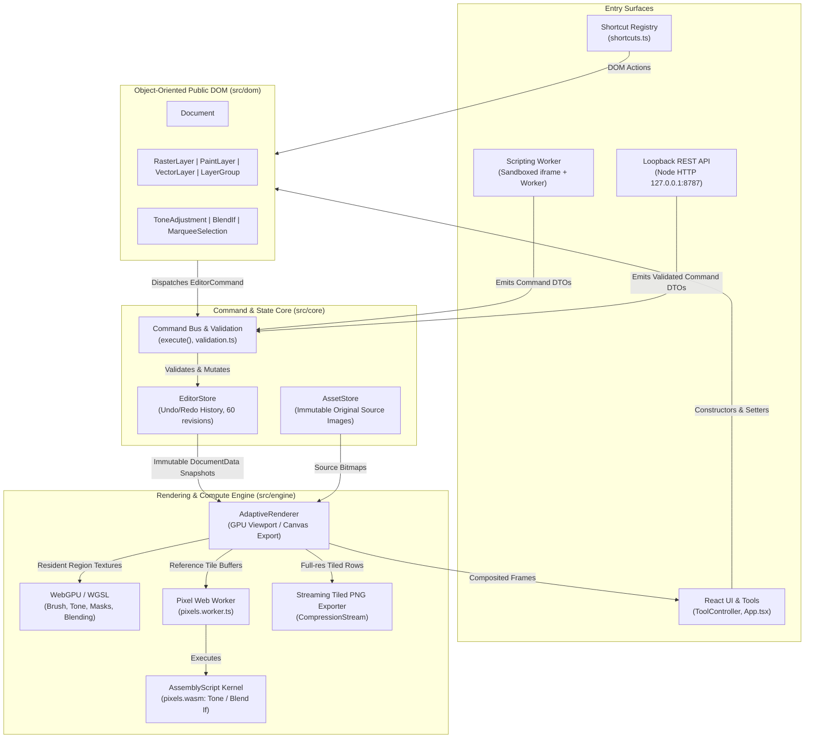

# Luma System Design & Architecture Specification

This document defines the system design, architectural boundaries, and non-negotiable invariants of Luma. All human contributors and AI coding agents working on this codebase must strictly adhere to these specifications.

---

## 1. High-Level Architecture

Luma is a browser-first, local-first image editor combining precision manual editing with future AI-assisted workflows. It decouples document representation, state mutation, image rendering, and execution surfaces.

---

## 2. Module Responsibilities & Boundaries

| Module                | Location                           | Responsibility & Rules                                                                                                                                                                   |
| :-------------------- | :--------------------------------- | :--------------------------------------------------------------------------------------------------------------------------------------------------------------------------------------- |
| **Public DOM**        | `src/dom/`                         | Public OOP constructors (`Document`, `RasterLayer`, `PaintLayer`, `VectorLayer`, `LayerGroup`, etc.). Browser-independent; wraps internal IDs; delegates attached mutations to commands. |
| **Core Model**        | `src/core/model.ts`, `drawing.ts`  | Plain, serializable Data Transfer Objects (DTOs) and structural schemas. Children are stored back-to-front. No UI state or pixel buffers.                                                |
| **Command Core**      | `src/core/commands.ts`, `store.ts` | Validated, atomic mutations and history management (undo/redo stack up to 60 revisions). Pure functions that transform document snapshots.                                               |
| **Validation**        | `src/core/validation.ts`           | Runtime schema validation (using Zod) for external commands and script results.                                                                                                          |
| **Asset Store**       | `src/core/assets.ts`               | Manages immutable original source images, small previews/thumbnails, and lifecycle cleanup.                                                                                              |
| **Persistence**       | `src/core/project.ts`              | Serializes and loads versioned `.luma` project files (JSON bundle containing document DTO and embedded base64 assets).                                                                   |
| **Rendering Engine**  | `src/engine/`                      | Decoupled compositing pipeline (`DocumentRenderer`, `CanvasRenderer`), tile management, pixel worker communication, and streaming PNG export.                                            |
| **WASM Kernel**       | `assembly/pixels.ts`               | High-performance AssemblyScript pixel operations (exposure, contrast, saturation and Blend If math; Canvas 2D handles blend modes) compiled to `pixels.wasm`.                            |
| **Scripting Sandbox** | `src/scripting/`                   | Worker-based isolated JavaScript runtime inside an opaque-origin iframe. Sandboxed execution with a 5-second timeout.                                                                    |
| **REST API**          | `server/`                          | Local loopback prototype service (`127.0.0.1:8787`) using in-memory documents and revision-based conflict detection.                                                                     |
| **UI & Tools**        | `src/ui/`, `src/tools.ts`          | React UI, gesture controllers, tool settings, centralized keyboard shortcuts, custom dark theme tokens.                                                                                  |

---

## 3. Non-Negotiable System Invariants

### 1. Unified Object-Oriented DOM with Stable ID Indirection

- The public programming interface is strictly object-oriented.
- **Detached vs. Attached:** Constructors (`new RasterLayer(...)`) create detached instances. Adding a layer to a document or group attaches it.
- **Dynamic Handle Indirection:** Attached objects do not store mutable state in class fields. Instead, they store a stable `id` and read properties directly from the current document revision in `EditorStore`.
- **Handle Survival Across Undo/Redo:** Because handles resolve state by ID against the active revision, handles retained in code or UI remain valid after undo/redo cycles.

### 2. Pure Command-Driven Mutation & Synchronous Transactions

- **No Direct State Mutation:** Document trees and snapshots are strictly immutable outside commands. All UI gestures, shortcuts, scripting calls, and REST endpoints emit `EditorCommand` objects.
- **Transaction Atomicity:** Multi-operation edits run inside `Document.transaction(label, callback)`. A transaction groups all child commands into exactly **one** undo history entry.
- **Synchronous Only:** Transactions are strictly synchronous. Asynchronous work (e.g. decoding images, running worker jobs) must complete _before_ opening a transaction.

### 3. Asset Immutability & Decoupled Memory Budgets (No Fixed MP Limits)

- **Preserve Original Pixels:** Original imported images are immutable source assets in `AssetStore`. Edits, transforms, and adjustments never overwrite source data.
- **No Arbitrary Resolution Caps:** Never add arbitrary megapixel, image-byte, or dimension limits (e.g., no 8192px cutoff). Document dimensions are numeric coordinates in JavaScript safe-integer space.
- **Decoupled Allocations:**
  - Viewport renders visible document regions into preview surfaces (budgeted to $\le 4\text{ MP}$ / $4096\text{px}$).
  - Interactive layer/mask caches retain at most 64 MiB plus a 16 MiB active-stroke surface; cache eviction never changes source resolution. Export and clone tiles bypass viewport caching.
  - Pixel filters run on small tiles ($\le 1024 \times 1024$) in worker threads.
  - Full-resolution PNG export streams scanlines in bounded chunks ($\sim 4\text{ MB}$) directly through `CompressionStream('deflate')`.

### 4. Sandbox Isolation for Automation Surfaces

- **Scripting Security:** Scripts run off the UI thread in a Web Worker inside an opaque-origin sandboxed iframe. Network access, browser DOM, host objects (`window`, `fetch`), and raw pixel buffers are strictly blocked.
- **DTO Validation:** Scripts return command DTOs that are validated against strict Zod schemas before being applied as an atomic transaction.
- **REST Boundary:** The local REST server operates on separate in-memory documents and enforces concurrency via `expectedRevision`.

### 5. Multi-Threaded Engine & WASM Boundary

- **No Pixel Loops on Main Thread:** Pixel manipulation must run inside `src/engine/pixels.worker.ts`.
- **GPU path:** WebGPU/WGSL handles supported viewport pixel work; Canvas/WASM remains the export/reference and unsupported-device/effect fallback. Device loss must trigger a new fallback frame. GPU allocations never impose image import limits. See `ARCHITECTURE.md` for current shader scope, working budgets, tolerances and verification limits.
- **AssemblyScript vs. TypeScript:** AssemblyScript is a distinct, constrained language used exclusively for numerical pixel kernels (`assembly/pixels.ts`). General UI and business logic must remain in TypeScript.

### 6. Bespoke Design System & Centralized Shortcuts

- **No Third-Party Component Frameworks:** Do not introduce `shadcn`, Tailwind UI, or external widget libraries. Use the custom tokens in `src/ui/tokens.css` and custom components in `src/ui/controls.tsx` and `src/ui/Dialog.tsx`.
- **Central Shortcut Registry:** Keyboard binding definitions belong in `src/ui/shortcuts.ts`; the UI registers document-dependent actions against those definitions. Shortcuts must automatically suspend when text fields (`input`, `textarea`, `select`) have focus.

---

## 4. Agent Decision Matrix for Implementing Features

| Feature Type              | Required Implementation Path                                                                                                                                                                                                                              | Strict Prohibitions                                                                       |
| :------------------------ | :-------------------------------------------------------------------------------------------------------------------------------------------------------------------------------------------------------------------------------------------------------- | :---------------------------------------------------------------------------------------- |
| **New Interactive Tool**  | Implement pointer gesture tracking in `src/tools.ts`. Use transient command previews, or the internal paint-preview adapter for frame-paced incremental brush/pencil rendering. Commit a final DOM command/transaction on pointer up.                                                                                                  | Never commit history entries on every `pointermove`.                                      |
| **New Layer Type**        | 1. Define DTO in `src/core/model.ts`. 2. Add Zod schema in `src/core/validation.ts`. 3. Implement OOP class in `src/dom/index.ts`. 4. Implement rendering in `src/engine/renderer.ts`. 5. Handle thumbnail rendering in `src/ui/App.tsx`. | Never access layer-specific fields (e.g., `assetId`) without discriminating `layer.kind`. |
| **New Pixel Adjustment**  | 1. Implement numerical kernel in `assembly/pixels.ts`. 2. Expose message in `src/engine/pixels.worker.ts`. 3. Add effect DTO & command in `src/core/`. 4. Create DOM class in `src/dom/`.                                                     | Never execute pixel manipulation loops on the main UI thread.                             |
| **New Keyboard Shortcut** | Register in `src/ui/shortcuts.ts` and update keyboard table in `docs/REQUIREMENTS.md`.                                                                                                                                                                    | Never add ad-hoc `window.addEventListener("keydown")` in UI components.                   |
| **Scripting API Change**  | Re-bundle runtime script (`npm run build:runtime`) and update `docs/SCRIPTING_API.md` with runnable examples and signatures in the same change.                                                                                                           | Never document planned or unverified capabilities.                                        |

---

## 5. Agent Verification Checklist

Before completing any task, an agent must execute and report the results of these verification steps:

1. **WASM Build:** `npm run build:wasm` passes with no errors.
2. **Typecheck & Production Build:** `npm run build` (`npm run build:engine && tsc -b && vite build`) completes with zero TypeScript errors or bundling failures.
3. **Unit & Integration Tests:** `npm test` passes all test suites (`tests/dom.test.ts`, `tests/wasm.test.ts`, `tests/api.test.ts`).
4. **Browser & Invariant Verification:** For substantial engine, UI, or rendering changes, run the relevant Playwright tests (`npx playwright test`).
5. **Documentation Parity:** Ensure `docs/REQUIREMENTS.md`, `docs/ARCHITECTURE.md`, or `docs/SCRIPTING_API.md` are updated if any public behavior, command, or shortcut was altered.
